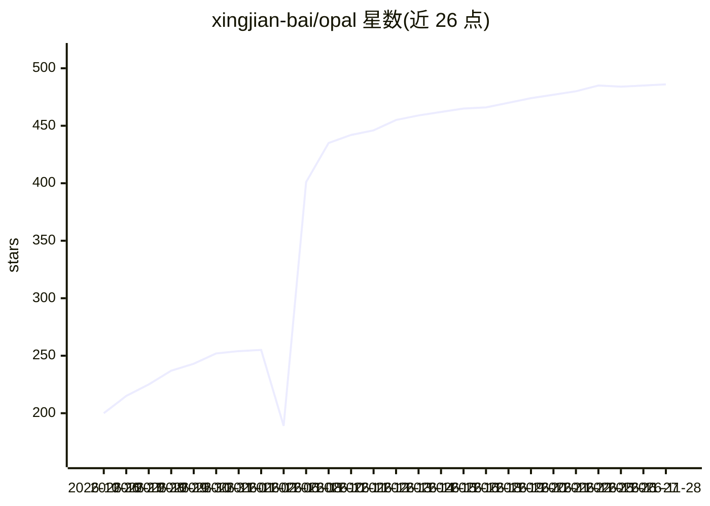

# xingjian-bai/opal

⭐ 486 · Python · MIT · 推送 2026-11-11 · [GitHub](https://github.com/xingjian-bai/opal) · [官网](https://xingjianbai.com/reactive-optimizers/) · 组织维护

**训练中由 coding agent 在线改写优化器的 PyTorch 包装器**

OPAL 将 PyTorch 优化器包装为一行代码的程序，训练过程中由编码 agent（默认 Claude Code）定期读取运行报告，改写两个小程序：将梯度转为参数更新的 optimizer 程序，以及自定义统计分析的 analysis 程序。agent 不得修改模型、数据、损失或评估；新程序先试运行 20 步，出错即回退，每个版本留存。默认等待 agent 决策，可用 blocking=False 并行；max_cost_usd 可限制 agent 开销。支持单 GPU、单节点 DDP 与 HF Trainer，尚不支持多节点/FSDP/DeepSpeed。

## 筛选速览

| 维度 | 判定 | 备注 |
|---|---|---|
| AI 角色 | `ai-ecosystem` | LLM/agent 周边工具 |
| 许可风险 | `permissive` | MIT |
| 部署形态 | `library` | 以包/库形式分发 |
| 模型依赖 | locked-api |  |
| 硬件要求 | — | 无带数字的原话,不猜 |
| 安装摩擦 | `medium` | 含编译或系统依赖之一 |
| 成熟度 | `idea` | |

## 能力要点

- 一行包装现有 torch.optim 优化器，未改动前与原训练逐位一致
- agent 可改写每参数组更新规则、学习率调度、momentum/β₂、预条件与裁剪等
- 新程序 20 步试运行，失败回退，全部版本保存在 programs/
- 提供 opal doctor/estimate 命令检查环境与预估等待时间和成本

## 适用场景

- 小时级以上的长训练任务中让 agent 在线调整优化器
- 在官方训练配方基础上尝试反应式优化器并复现论文设置
- 通过 Hugging Face Trainer 无 agent 试用 OPAL 的 keep 模式

## 场景标签

`编码 Agent` `模型训练` · 领域:编码与开发

## 证据(README 行号)

> L3:  A PyTorch optimizer wrapper that lets a coding agent change the optimizer while your model trains.
> L13: the Loop) turns the optimizer into a program that an agent keeps rewriting during the run. You wrap your PyTorch
> L26: Open your own project in a coding agent (Claude Code, Codex, Cursor or similar) and paste this prompt. The agent

## 星数曲线

2026-10-26 200 → 2026-11-28 486（+286）

---
*卡片 v1 · prompt 1.4 · 生成 2026-11-25 · 置信度 high · 依据 README sha `6c66583d5e10` · [字段定义](../../DATASET.md)*
