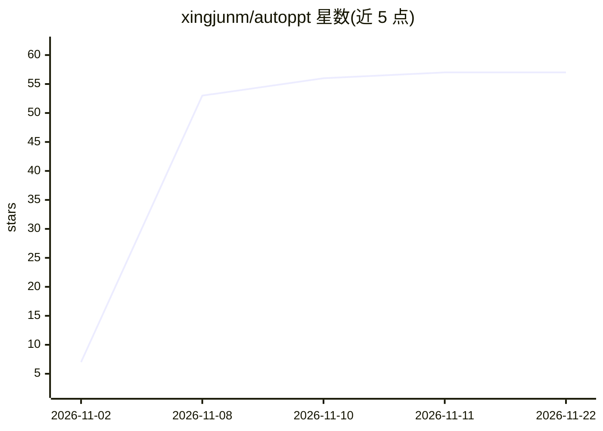

# xingjunm/autoppt

⭐ 57 · CSS · MIT · 推送 2026-11-02 · [GitHub](https://github.com/xingjunm/autoppt) · 个人维护 · 中文 README

**给教师用的一句话生成交互式 HTML 课件工具**

面向教师的课件生成工具：由 AI 编程智能体（Claude Code、OpenAI Codex）加载的技能包加课件引擎构成。教师说出课程主题或提供教学大纲，智能体先做需求访谈与课程内容设计，教师确认设计文档后生成一整周三节课的 HTML 课件，含每页讲稿、浏览器内真实计算的互动组件、可运行的实践课代码与 Notebook，并做冒烟测试、文字重叠检查与逐页截图；自动生成学生版与教师指南。课件为纯文本（HTML/CSS/JS），离线双击 index.html 可用，可加 ?print-pdf 导出 PDF，不生成 .pptx。源自复旦大学一门 16 周通识课的 14 周真实课件制作，仓库附第 1 周示例。安装需 git clone 后运行 install.py，另有 Python 3.9+、Node.js 18+ 与 Playwright 等依赖。

## 筛选速览

| 维度 | 判定 | 备注 |
|---|---|---|
| AI 角色 | `ai-native` | 本体是模型或模型工具 |
| 许可风险 | `permissive` | MIT |
| 部署形态 | `library` | 以包/库形式分发 |
| 模型依赖 | locked-api |  |
| 硬件要求 | — | 无带数字的原话,不猜 |
| 安装摩擦 | `low` | 无编译、无系统依赖或容器化 |
| 成熟度 | — | 结构信号不足 |

## 能力要点

- 一句话生成一整周三节课的 16:9 HTML 课件，含每页完整讲稿
- 浏览器内真实计算的互动组件，与 Python 结果逐项对照
- 实践课代码、输出、Notebook 出自同一次真实运行
- 自动生成学生版、分钟级教师指南、事实出处与图片来源页

## 适用场景

- 教师备课：说一句话生成交互式课件，改设计文档精修
- 整门课规划：给教学大纲让智能体整理学期内容设计
- 实践课教学：学生拿到可直接运行且结果一致的代码与 Notebook

## 场景标签

`代码生成` · 领域:编码与开发

## 证据(README 行号)

> L26: AutoPPT 是一款“AI备课神器”：一套**给 AI 编程智能体（Claude Code、OpenAI Codex）用的技能（skill）+ 课件引擎**。你只要说出课程主题（或者给它一份教学大纲），智能体就按固定流程交付**
> L3:  AI备课神器：只需一句话，即可一键生成一整周精美、可交互的 HTML 格式教学课件。

## 星数曲线

2026-11-02 7 → 2026-11-22 57（+50）

---
*卡片 v1 · prompt 1.4 · 生成 2026-11-18 · 置信度 mid · 依据 README sha `955f89d6d0ce` · [字段定义](../../DATASET.md)*
