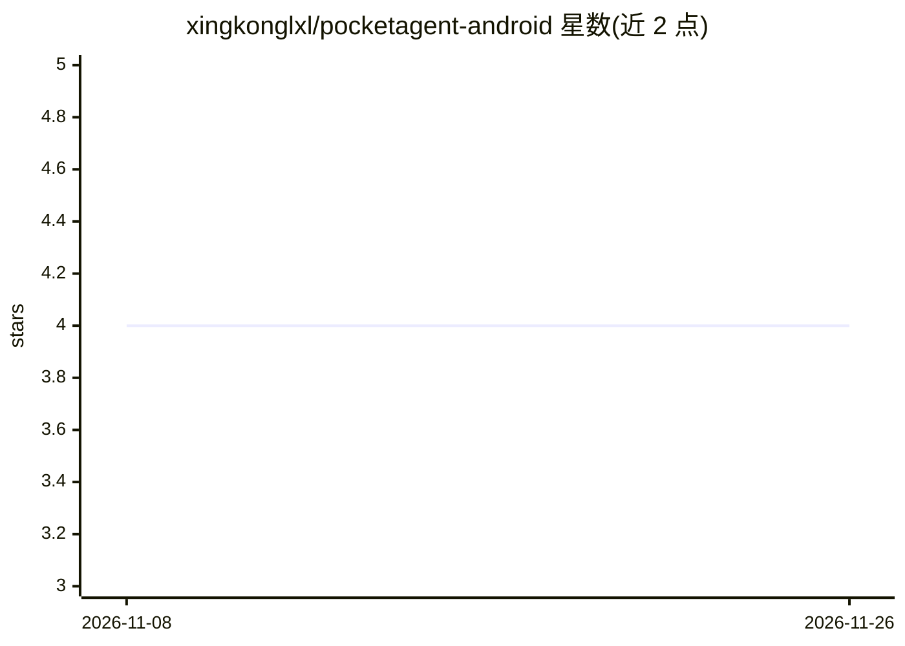

# xingkonglxl/pocketagent-android

⭐ 4 · Kotlin · NOASSERTION · 推送 2026-11-24 · [GitHub](https://github.com/xingkonglxl/pocketagent-android) · 个人维护 · 中文 README

**让手机接续电脑上 AI agent 工作的 Android 客户端**

Android 应用，通过 SSH 连接用户自己的 Mac/Linux 电脑与服务器，在远端执行命令与读写文件；支持手机与电脑间双向同步会话并在冲突时人工选择保留哪边，可检测远端 Codex 并续接其原生 session。手机端不运行模型，请求发往用户自配的模型服务商（BYOK）。API Key 与 SSH 私钥经系统 Keystore 加密存储。提供 APK 安装包与 SHA256/签名校验，源码以 PolyForm Noncommercial 1.0.0 发布，商业用途需单独授权。

## 筛选速览

| 维度 | 判定 | 备注 |
|---|---|---|
| AI 角色 | `ai-native` | 本体是模型或模型工具 |
| 许可风险 | `none` | NOASSERTION |
| 部署形态 | `None` |  |
| 模型依赖 | locked-api |  |
| 硬件要求 | — | 无带数字的原话,不猜 |
| 安装摩擦 | `medium` | 含编译或系统依赖之一 |
| 成熟度 | — | 结构信号不足 |

## 能力要点

- 手机⇄电脑双向同步会话，冲突时选择保留
- SSH 远程执行与跳板机/反向隧道连接
- 支持 DeepSeek、OpenAI/Codex、Claude 及 OpenAI 兼容接口
- 逐次确认的审批机制与 Keystore 加密密钥存储

## 适用场景

- 通勤路上续接电脑上未完成的编码会话
- 在客户现场用手机 SSH 查看服务器日志与状态
- 手机不存项目文件、直接改远端目录里的代码

## 场景标签

`编码 Agent` · 领域:编码与开发

## 证据(README 行号)

> L27: |手机不跑模型、不跑代码|模型请求直接发给你配置的服务商，命令在远端机器执行|
> L56: |**远端 Codex harness 接力**|`/workspace` 自动检测目标机器的 Codex，支持 Mac / Linux 及常见 Node 安装器，可手动指定特殊安装路径；检测到后整轮交给该机 Codex；同步来的

## 星数曲线

2026-11-08 4 → 2026-11-26 4（+0）

---
*卡片 v1 · prompt 1.4 · 生成 2026-11-21 · 置信度 mid · 依据 README sha `b446fae67cab` · [字段定义](../../DATASET.md)*
