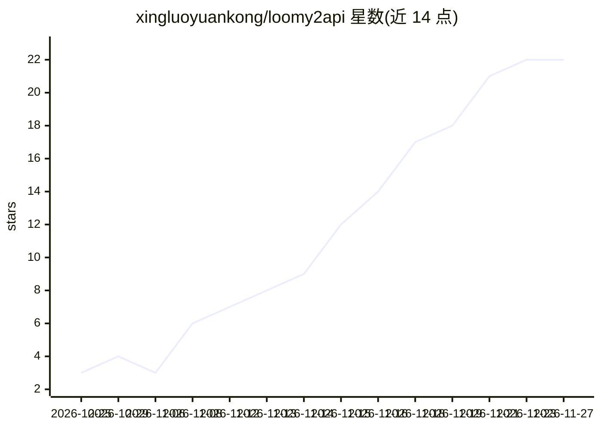

# xingluoyuankong/loomy2api

⭐ 22 · Python · MIT · 推送 2026-11-14 · [GitHub](https://github.com/xingluoyuankong/loomy2api) · 个人维护 · 中文 README

**讯飞星火 Loomy 平台的 OpenAI/Anthropic 兼容 API 网关**

用 Go/Python 编写的反向代理网关：将讯飞星火 Loomy 平台封装为 OpenAI 兼容接口（/v1/chat/completions、/v1/embeddings、/v1/images/generations）与 Anthropic 兼容接口（/v1/messages），支持流式、工具调用与 reasoning_effort 档位。核心机制是多账号池：weighted 轮询、Top-N 选号、粘性会话、429 软冷却与熔断；面板支持短信/微信扫码/密码登录自动入池、用量台账落盘、积分对账与每日签到等平台任务。防风控做法包括请求字段与官方客户端逐字节对齐、操作随机抖动、per-account 出口代理。README 声明仅供学习研究。

## 筛选速览

| 维度 | 判定 | 备注 |
|---|---|---|
| AI 角色 | `ai-ecosystem` | LLM/agent 周边工具 |
| 许可风险 | `permissive` | MIT |
| 部署形态 | `None` |  |
| 模型依赖 | — | README 未给出锁定关系 |
| 硬件要求 | — | 无带数字的原话,不猜 |
| 安装摩擦 | `low` | 无编译、无系统依赖或容器化 |
| 成熟度 | — | 结构信号不足 |

## 能力要点

- OpenAI/Anthropic 双兼容 API 暴露（含流式、工具调用、reasoning_effort）
- 多账号池：weighted 轮询、粘性会话、429 软冷却、熔断
- 面板内短信/微信扫码/密码登录，账号自动入池并持久化
- 用量台账落盘（JSONL 追加写）与积分上游流水对账

## 适用场景

- 把讯飞星火 Loomy 接入只支持 OpenAI/Anthropic 协议的客户端
- 多账号聚合轮询以扩大可用额度
- 通过 Web 面板管理账号、用量与平台任务（签到/兑换码）

## 场景标签

`模型网关` · 领域:Agent 开发

## 证据(README 行号)

> L3: 讯飞星火 Loomy 平台的 OpenAI/Anthropic 兼容网关：把账号池化，暴露标准 API。
> L9: - **OpenAI 兼容**：`/v1/chat/completions`（流式/非流式/工具调用/`reasoning_effort` 思考档位）、`/v1/embeddings`、`/v1/images/generations
> L10: - **Anthropic 兼容**：`/v1/messages`

## 星数曲线

2026-10-25 3 → 2026-11-27 22（+19）

---
*卡片 v1 · prompt 1.4 · 生成 2026-11-18 · 置信度 high · 依据 README sha `f3f10ccfd2f2` · [字段定义](../../DATASET.md)*
