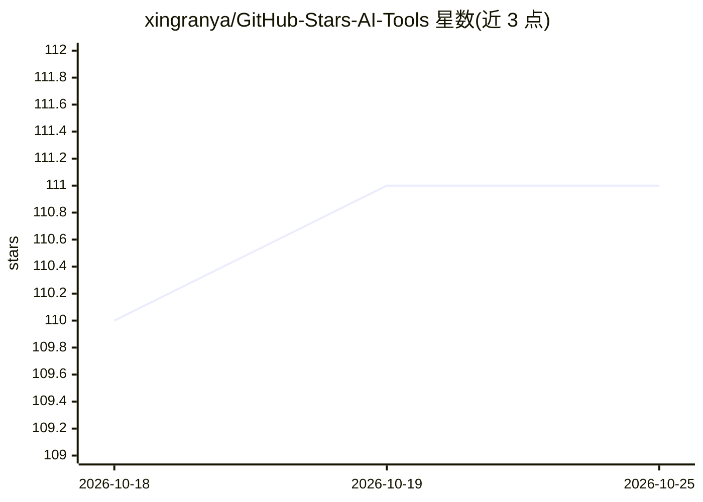

# xingranya/GitHub-Stars-AI-Tools

⭐ 111 · TypeScript · NOASSERTION · 推送 2026-07-15 · [GitHub](https://github.com/xingranya/GitHub-Stars-AI-Tools) · [官网](https://gsat.xran.uk) · 个人维护 · 中文 README

**把 GitHub Stars 变成本地可搜索可追问的 AI 知识库**

基于 Tauri（Rust + React）的本地优先桌面应用：同步 GitHub Stars 到本机 SQLite，保留仓库元数据、Topics、语言、README、标签与笔记；首次启用时下载中英双语 Embedding 模型，通过 SQLite 与 zvec 在本机完成语义召回，下载后可离线检索。AI 能力包括聊天式搜索（向量召回候选后由 AI 筛选）、README 中文摘要与知识卡生成、标签网络和相似项目发现。AI 服务支持 OpenAI、Anthropic、OpenAI 兼容接口及多家预设。采用 PolyForm Noncommercial License，禁止商用。

## 筛选速览

| 维度 | 判定 | 备注 |
|---|---|---|
| AI 角色 | `ai-native` | 本体是模型或模型工具 |
| 许可风险 | `none` | NOASSERTION |
| 部署形态 | `None` |  |
| 模型依赖 | local-ok | 支持本地模型 |
| 硬件要求 | — | 无带数字的原话,不猜 |
| 安装摩擦 | `low` | 无编译、无系统依赖或容器化 |
| 成熟度 | — | 结构信号不足 |

## 能力要点

- Stars 同步到本机 SQLite，保留 README、标签、笔记与阅读状态
- 本地向量检索：下载双语 Embedding 模型后可离线语义召回
- 聊天式 AI 搜索：先向量召回再由 AI 筛选并同步生成回答与仓库列表
- README AI 解析生成中文摘要、关键词、建议标签与项目知识卡

## 适用场景

- Stars 太多想不起某个项目解决什么问题时，用自然语言搜索并追问
- 把收藏项目的 README、标签、笔记和 AI 摘要沉淀在本机
- 基于已收藏项目发现替代或同类项目，整理技术栈偏好

## 场景标签

`知识库管理` `语义搜索` · 领域:知识与检索

## 证据(README 行号)

> L3:  把 GitHub Stars 变成可搜索、可总结、可继续追问的本地 AI 知识库。
> L32: |聊天式 AI 搜索|像对话一样描述需求，先从本地向量索引召回候选，再由 AI 筛选并同步生成回答和最终仓库列表|
> L31: |本地向量检索|首次启用时下载中英双语 Embedding 模型，通过 SQLite 与 zvec 在本机完成语义召回，下载后可离线检索|

## 星数曲线

2026-10-18 110 → 2026-10-25 111（+1）

---
*卡片 v1 · prompt 1.4 · 生成 2026-10-23 · 置信度 high · 依据 README sha `3cc87954a373` · [字段定义](../../DATASET.md)*
