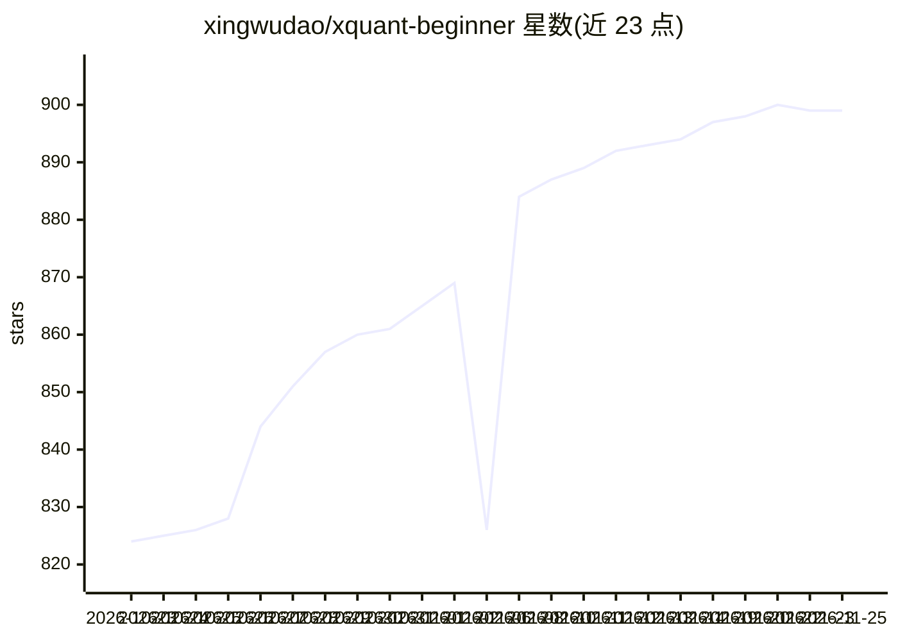

# xingwudao/xquant-beginner

⭐ 899 · TypeScript · NOASSERTION · 推送 2026-11-02 · [GitHub](https://github.com/xingwudao/xquant-beginner) · [官网](https://xingwudao.github.io/xquant-beginner/) · 个人维护 · 中文 README

**面向零基础读者的量化交易自学开源书：用 AI 与 Python 跑通回测**

一本以 Vibe Coding 方式组织的量化交易入门开源书：读者用自然语言描述投资想法，由 AI 编程工具辅助生成并运行 Python 代码，依次完成策略规格说明、数据获取、回测、基准对比、风险评估，并检查过拟合、数据泄露等常见问题。全书围绕 9 个问题组织，配套练习与 notebook 维护在另一仓库，支持 GitBook 与 VitePress 两种发布方式，书稿仅用于教育研究并声明不构成投资建议。

## 筛选速览

| 维度 | 判定 | 备注 |
|---|---|---|
| AI 角色 | `ai-knowledge` | 知识聚合/清单类 |
| 许可风险 | `none` | NOASSERTION |
| 部署形态 | `library` | 以包/库形式分发 |
| 模型依赖 | — | README 未给出锁定关系 |
| 硬件要求 | — | 无带数字的原话,不猜 |
| 安装摩擦 | `low` | 无编译、无系统依赖或容器化 |
| 成熟度 | — | 结构信号不足 |

## 能力要点

- 以 Vibe Coding 方式学习：先描述想法，AI 辅助生成与运行代码
- 覆盖策略规格→回测→风险评估→过拟合检查的完整研究路径
- 9 章覆盖选股、仓位、交易规则、执行监控与因子研究
- 支持 GitBook 与 VitePress 两种在线发布方式

## 适用场景

- 零基础入门量化交易并跑通第一个策略回测
- 自学 Python 量化时被环境和报错卡住需要指引
- 建立系统的回测评估方法，识别过拟合与数据泄露

## 场景标签

`金融量化` `教程课程` · 领域:学习与行业

## 证据(README 行号)

> L1: # AI 量化交易入门：《人人都是量化交易员》开源书
> L5: 《XQuant：人人都是量化交易员》采用 Vibe Coding（氛围编程）的
> L9: 这是一本面向零基础读者的量化交易自学开源书。你不需要先成为

## 星数曲线

2026-10-23 824 → 2026-11-25 899（+75）

---
*卡片 v1 · prompt 1.4 · 生成 2026-11-24 · 置信度 high · 依据 README sha `ff995c9593b5` · [字段定义](../../DATASET.md)*
