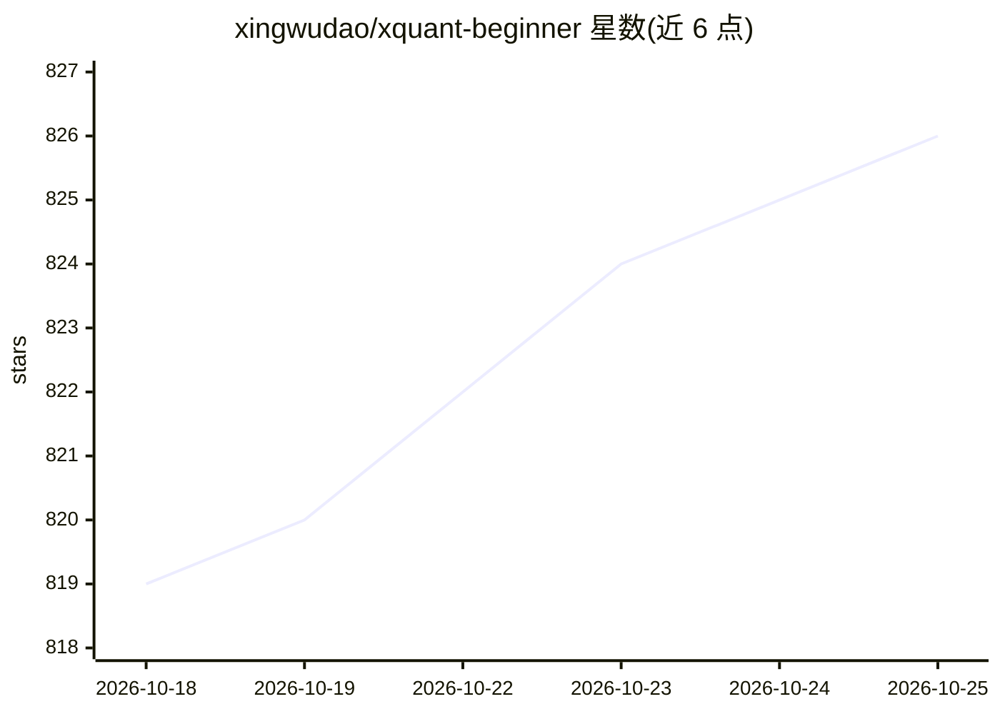

# xingwudao/xquant-beginner

⭐ 828 · TypeScript · NOASSERTION · 推送 2026-09-02 · [GitHub](https://github.com/xingwudao/xquant-beginner) · [官网](https://xingwudao.github.io/xquant-beginner/) · 个人维护 · 中文 README

**面向零基础读者的量化交易 AI+Python 自学开源书**

由刑无刀等人撰写的量化交易入门开源书稿仓库，采用 Vibe Coding 学习路径：读者先描述投资想法，让 AI 辅助生成并运行 Python 代码，再通过数据回测验证策略。内容覆盖策略规格说明书、回测、收益与风险评估、过拟合与数据泄露检查、交易执行和因子研究共 9 个问题。配套练习的 spec 与 notebook 维护在独立的 xquant-learning 仓库。本仓库本身存放书稿源码与发布配置，支持 GitBook 与 VitePress 两种发布方式，需 Node.js 环境本地预览。作者另运营 XQuant-Shop 商业平台与付费课程。

## 筛选速览

| 维度 | 判定 | 备注 |
|---|---|---|
| AI 角色 | `ai-knowledge` | 知识聚合/清单类 |
| 许可风险 | `none` | NOASSERTION |
| 部署形态 | `library` | 以包/库形式分发 |
| 模型依赖 | — | README 未给出锁定关系 |
| 硬件要求 | — | 无带数字的原话,不猜 |
| 安装摩擦 | `low` | 无编译、无系统依赖或容器化 |
| 成熟度 | — | 结构信号不足 |

## 能力要点

- AI 辅助生成与运行 Python 代码的量化学习路径（Vibe Coding）
- 9 个问题组织内容：从环境搭建到回测、风控、交易执行与因子研究
- 支持 GitBook 同步发布与 VitePress 静态站点构建
- 配套练习仓库独立维护 spec 与 notebook

## 适用场景

- 零基础入门量化交易并系统学习回测与评估方法
- 被代码和环境问题卡住的 Python 量化自学者
- 学习用 AI 编程工具把投资想法转化为可验证策略

## 场景标签

`金融量化` `教程课程` · 领域:学习与行业

## 证据(README 行号)

> L3: 用 AI 编程工具和 Python，从零跑通策略回测、风险评估与因子研究。
> L9: 这是一本面向零基础读者的量化交易自学开源书。你不需要先成为
> L18: - 让 AI 辅助生成和运行 Python 代码

## 星数曲线

2026-10-18 819 → 2026-10-25 826（+7）

---
*卡片 v1 · prompt 1.4 · 生成 2026-10-21 · 置信度 high · 依据 README sha `ac1114a4e524` · [字段定义](../../DATASET.md)*
