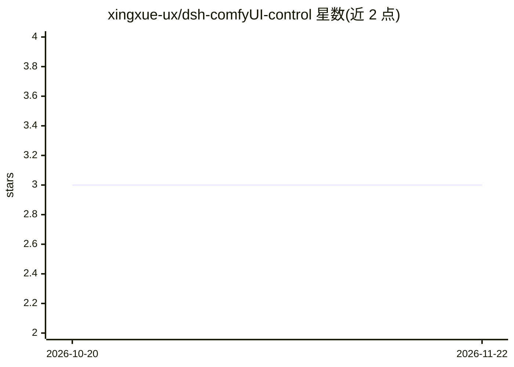

# xingxue-ux/dsh-comfyUI-control

⭐ — · [GitHub]() · 个人维护 · 中文 README

**把本地 ComfyUI 接入 DeepSeek Harness 绘图模式的插件**

DeepSeek Harness（DSH）0.2 的 bundle 插件，在「绘图模式」Agent 预设下挂载 19 个 comfyui_* 工具，复刻上游 good-comfyui-mcp 的 13 个工具并补齐控制面与复刻自检。功能覆盖 Anima/Krea2 出图、Civitai LoRA 搜索下载与 hash 反查、Danbooru 角色 tag 查询、PNG 元数据解析、小番茄混淆图还原等。零运行时依赖，只用 Node 内置模块与全局 fetch，不需要 Python MCP 进程；仅在绘图模式预设生效，需本地运行 ComfyUI（默认 8188 端口）与 8899 对比页服务。

## 筛选速览

| 维度 | 判定 | 备注 |
|---|---|---|
| AI 角色 | `ai-ecosystem` | LLM/agent 周边工具 |
| 许可风险 | `permissive` | — |
| 部署形态 | `library` | 以包/库形式分发 |
| 模型依赖 | local-ok | 支持本地模型 |
| 硬件要求 | — | 无带数字的原话,不猜 |
| 安装摩擦 | `low` | 无编译、无系统依赖或容器化 |
| 成熟度 | — | 结构信号不足 |

## 能力要点

- 19 个 comfyui_* 工具，复刻上游 13 个工具语义
- Anima 管线（默认）与 Krea2 引擎出图，可覆盖 steps/cfg/sampler/尺寸/seed
- 复刻自检：按上游样例元数据出图并与原图并排目视对比
- PNG 元数据解析与 Gilbert 曲线混淆图还原（enc/dec）

## 适用场景

- 让 DSH Agent 通过绘图模式预设控制本地 ComfyUI 出图
- 从 Civitai 搜索并下载精确版本的 LoRA，并按 hash 核对来源
- 验证本地出图环境与上游参考是否一致
- 解析生成图的 PNG 元数据或还原小番茄混淆图

## 场景标签

`图像生成` · 领域:内容生成

## 证据(README 行号)

> L7: 把本地 ComfyUI 接进一个名为 **绘图模式** 的 Agent 预设里，完整复刻
> L16: 零运行时依赖：只用 Node 内置模块 + 全局 `fetch`，不需要 pip、不需要常驻 Python MCP 进程。
> L172: - **实现方式不同**：上游是 Python MCP 进程；本插件是 DSH 进程内的原生工具，

## 星数曲线

2026-10-20 3 → 2026-11-22 3（+0）

---
*卡片 v1 · prompt 1.4 · 生成 2026-11-22 · 置信度 high · 依据 README sha `198a2109aa55` · [字段定义](../../DATASET.md)*
