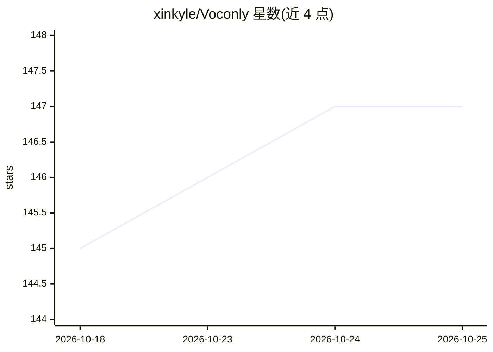

# xinkyle/Voconly

⭐ 147 · C++ · MIT · 推送 2026-10-24 · [GitHub](https://github.com/xinkyle/Voconly) · [官网](https://voconly.vercel.app) · 个人维护 · 中文 README

**本地优先的 AI 语音输入工具：说话即得润色后的文字**

基于 Tauri 2.0 + React + Rust 构建的桌面语音听写应用：本地运行 ASR 模型（Whisper/SenseVoice/Parakeet/Qwen-ASR）做实时转写，可选接入 Ollama 本地或云端 LLM 对转写文本做润色、翻译、会议纪要等后处理，成品文字直接落在光标处。支持为不同处理模式分配独立热键，也支持双击跳过 AI 输出原始转写。音频处理用纯 Rust 实现，无需 ffmpeg。提供 Windows 与 macOS（Apple Silicon）安装包，Linux 不在计划内。

## 筛选速览

| 维度 | 判定 | 备注 |
|---|---|---|
| AI 角色 | `ai-native` | 本体是模型或模型工具 |
| 许可风险 | `permissive` | MIT |
| 部署形态 | `None` |  |
| 模型依赖 | local-ok | 支持本地模型 |
| 硬件要求 | — | 无带数字的原话,不猜 |
| 安装摩擦 | `medium` | 含编译或系统依赖之一 |
| 成熟度 | — | 结构信号不足 |

## 能力要点

- 本地 ASR 转写，音频不出设备，可完全离线
- LLM 后处理：轻度润色/专业润色/翻译/会议纪要/自定义 prompt
- 多模式各配独立热键，双击停止可跳过 AI 直接输出原始转写
- 纯 Rust 音频处理，支持 WAV/MP3/M4A/OGG/FLAC，无需 ffmpeg

## 适用场景

- 在任意可输入的应用里用语音代替打字
- 长会议或长篇口述时持续听写并生成结构化纪要
- 语音输入后自动去除口语冗余或做中英翻译
- 注重隐私、要求音频不上云的离线听写场景

## 场景标签

`语音识别` · 领域:感知与多模态

## 证据(README 行号)

> L83: - **ASR:** Whisper · SenseVoice · Parakeet · Qwen-ASR
> L84: - **LLM:** Ollama (local) + major cloud API providers
> L123: - LLM post-processing: quick note / professional / translation / meeting / custom

## 星数曲线

2026-10-18 145 → 2026-10-25 147（+2）

---
*卡片 v1 · prompt 1.4 · 生成 2026-10-23 · 置信度 high · 依据 README sha `9888a1d0628a` · [字段定义](../../DATASET.md)*
