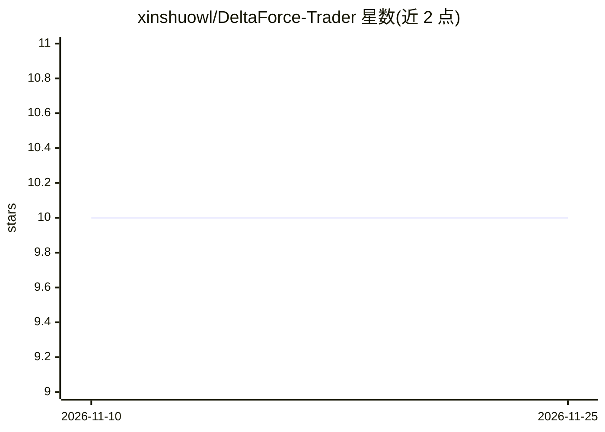

# xinshuowl/DeltaForce-Trader

⭐ 10 · Python · MIT · 推送 2026-05-18 · [GitHub](https://github.com/xinshuowl/DeltaForce-Trader) · [官网](https://github.com/xinshuowl/DeltaForce-Trader/releases/latest) · 个人维护 · 中文 README

**三角洲行动玩家用的交易行自动批量上架/下架工具**

面向《三角洲行动》玩家的交易行自动化 GUI 工具：一键把仓库内非绑定道具批量挂上交易行，挂满 15 槽后循环等待成交、下架、整理仓库，支持挂机模式无人值守运行。核心机制包括 RandomForest 模型 + HSV 规则双引擎区分绑定/非绑定道具、连通域合并避免重复点击同一多格道具、名字+图像指纹(dHash)+位置黑名单三层去重，并提供 30+ 项坐标可视化校准。仅适配 Windows 2560×1440 分辨率与 150% 缩放，须管理员权限运行。

## 筛选速览

| 维度 | 判定 | 备注 |
|---|---|---|
| AI 角色 | `ai-enhanced` | 去掉 AI 部分产品仍成立 |
| 许可风险 | `permissive` | MIT |
| 部署形态 | `desktop` | 安装包/桌面程序 |
| 模型依赖 | — | README 未给出锁定关系 |
| 硬件要求 | — | 无带数字的原话,不猜 |
| 安装摩擦 | `low` | 无编译、无系统依赖或容器化 |
| 成熟度 | — | 结构信号不足 |

## 能力要点

- RandomForest + HSV 规则双引擎检测绑定/非绑定道具，GUI 内审核标注后一键重训
- 连通域合并 + 名字/图像指纹/位置三层去重跨页机制
- 30+ 项坐标与 OCR 区可视化校准，持久化到 user_config.json
- 挂机模式：上架 15 槽→等待→自动下架→整理→循环重启

## 适用场景

- 批量把整箱非绑定道具挂上交易行，省去手动逐个操作
- 挂机模式下自动上下架并循环整理仓库
- 按品质/分类/箱子筛选精确控制上架哪些道具

## 场景标签

`GUI 自动化` · 领域:效率与自动化

## 证据(README 行号)

> L1: # 三角洲行动 · 交易行自动上架 / 下架助手
> L58: - **ML 道具检测** — RandomForest 模型 + HSV 规则双引擎，区分绑定 / 非绑定道具，可在 GUI 内审核标注后一键重训。
> L16: 支持品质 / 分类精确筛选、ML 模型识别、多箱子轮询挂机。

## 星数曲线

2026-11-10 10 → 2026-11-25 10（+0）

---
*卡片 v1 · prompt 1.4 · 生成 2026-11-19 · 置信度 high · 依据 README sha `31c8609a8e8a` · [字段定义](../../DATASET.md)*
