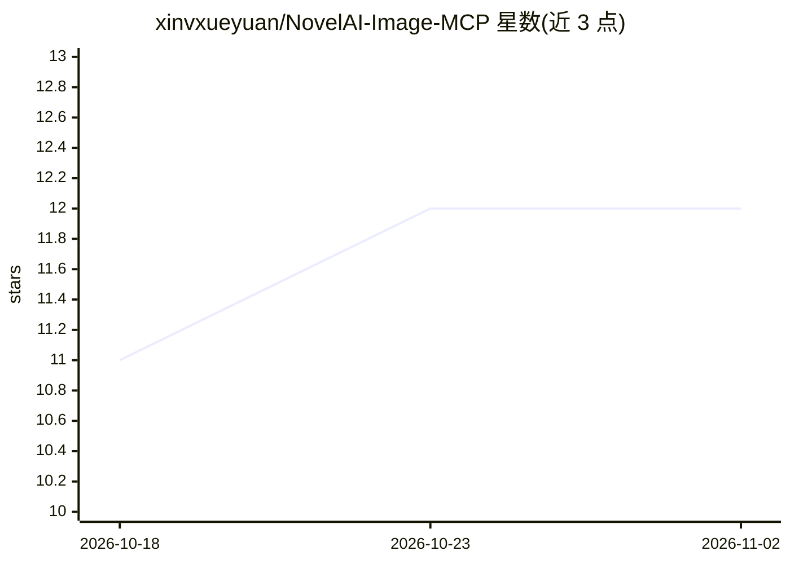

# xinvxueyuan/NovelAI-Image-MCP

⭐ 12 · Python · MIT · 推送 2026-10-31 · [GitHub](https://github.com/xinvxueyuan/NovelAI-Image-MCP) · [官网](https://xinvxueyuan.github.io/NovelAI-Image-MCP/) · 个人维护 · 中文 README

**将 NovelAI 图像生成以 MCP 工具形式接入 AI agent 的服务器**

基于 FastMCP 4 与 MCP SDK v2 的服务器，把 NovelAI 图像 API（txt2img/img2img/inpaint、4× 放大、Director 工具、ControlNet 标注、tag 建议等）封装为 11 个 MCP 工具，供 Claude Desktop、Cline 等支持 MCP 的 agent 调用；另有 6 个子命令的同步 CLI 和 3 个 skills.sh 技能包。支持 stdio/HTTP 两种传输，HTTP 可用 bearer token 保护并提供按路由的输出目录与 JSONL 审计日志（不记录明文提示词与凭据）。通过 pip/uvx 安装，也可 Docker 部署。

## 筛选速览

| 维度 | 判定 | 备注 |
|---|---|---|
| AI 角色 | `ai-ecosystem` | LLM/agent 周边工具 |
| 许可风险 | `permissive` | MIT |
| 部署形态 | `self-host` | docker 或自建部署 |
| 模型依赖 | — | README 未给出锁定关系 |
| 硬件要求 | — | 无带数字的原话,不猜 |
| 安装摩擦 | `low` | 无编译、无系统依赖或容器化 |
| 成熟度 | — | 结构信号不足 |

## 能力要点

- 11 个 MCP 工具覆盖 NovelAI 图像 API（生成/放大/标注/账户等）
- stdio + HTTP 双传输，HTTP 支持 bearer token 与路由级审计日志
- 同步 CLI 六个子命令，可在 MCP 宿主外的脚本/CI 中使用
- 3 个 skills.sh 技能包经 npx skills add 一键安装

## 适用场景

- 让 Claude Desktop/Cline 等 agent 直接生成与编辑 NovelAI 图像
- 在脚本或 CI 中用 CLI 批量调用 NovelAI 生成
- 自部署 HTTP 端点供多个远程 agent 客户端共用

## 场景标签

`图像生成` · 领域:内容生成

## 证据(README 行号)

> L20: An [MCP (Model Context Protocol)][mcp] server that exposes **NovelAI image
> L25: Built on FastMCP 4 (the fastmcp framework over the MCP SDK v2 `mcp>=2.3.0`),

## 星数曲线

2026-10-18 11 → 2026-11-02 12（+1）

---
*卡片 v1 · prompt 1.4 · 生成 2026-10-31 · 置信度 high · 依据 README sha `9a64c6c1c42d` · [字段定义](../../DATASET.md)*
