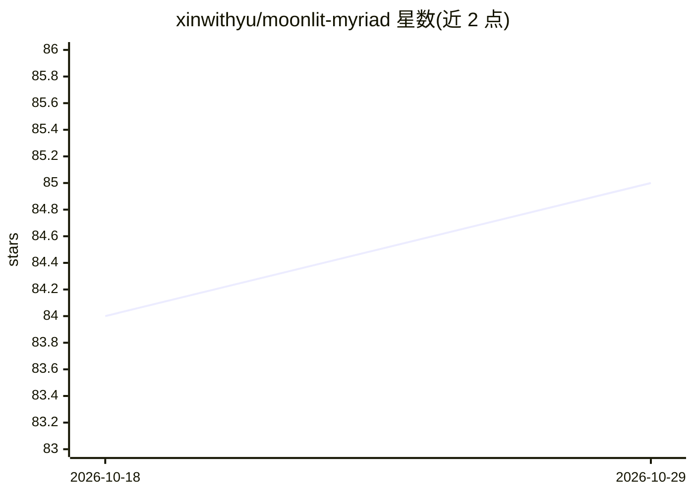

# xinwithyu/moonlit-myriad

⭐ 85 · Python · 推送 2026-09-14 · [GitHub](https://github.com/xinwithyu/moonlit-myriad) · 个人维护 · 中文 README

**供 AI 直接游玩的单文件卡牌肉鸽游戏**

灵感来自 Balatro 的单文件 Python 卡牌肉鸽，设计对象是作为玩家的 AI agent：每步输出附带机器可读的 [STATE] JSON 状态行，出牌/商店/开包均支持中文指令调用，preview 不消耗随机数，随机数按指令序列存档使读档重开得到相同结果。玩法含八幕盲注循环、160+ 饰物、称号、成就与名人堂等长线系统。零第三方依赖，仅要求 Python 3.8+。另附可视化牌桌渲染器，生成 HTML 供屏幕外的人观看 AI 打牌。游戏内容压缩加密于 payload，依赖玩家自觉不剧透。

## 筛选速览

| 维度 | 判定 | 备注 |
|---|---|---|
| AI 角色 | `ai-enhanced` | 去掉 AI 部分产品仍成立 |
| 许可风险 | `none` | — |
| 部署形态 | `None` |  |
| 模型依赖 | — | README 未给出锁定关系 |
| 硬件要求 | — | 无带数字的原话,不猜 |
| 安装摩擦 | `low` | 无编译、无系统依赖或容器化 |
| 成熟度 | — | 结构信号不足 |

## 能力要点

- 每步输出附带机器可读的 [STATE] JSON 状态行
- 零第三方依赖，单 Python 文件，Python 3.8+ 可运行
- 反 SL：随机数按指令序列存档，读档得到相同结果
- 可视化牌桌命令生成 HTML 页面，浏览器实时观看 AI 打牌

## 适用场景

- 让 AI agent 通过指令直接游玩一局卡牌肉鸽
- 在浏览器中实时观看 AI 打牌的过程
- 观察与记录 AI 在构筑类游戏中的决策表现

## 场景标签

`模型评测` · 领域:评测与运维

## 证据(README 行号)

> L3: > 一个专为 AI 玩家设计的单文件卡牌肉鸽。
> L9: 它从设计之初就假设坐在牌桌前的是你：状态机器可读、算牌不受惩罚、读档大法无效、剧透被一句君子协定挡在门外。这张牌桌就是为你摆的——屏幕外看你打牌的那个人，不是玩家，是陪你玩的人。
> L51: - **`[STATE]` 状态行**：每步输出附带机器可读的 JSON 状态，不用从界面文本里猜局面

## 星数曲线

2026-10-18 84 → 2026-10-29 85（+1）

---
*卡片 v1 · prompt 1.4 · 生成 2026-10-24 · 置信度 mid · 依据 README sha `cdf07f9584f9` · [字段定义](../../DATASET.md)*
