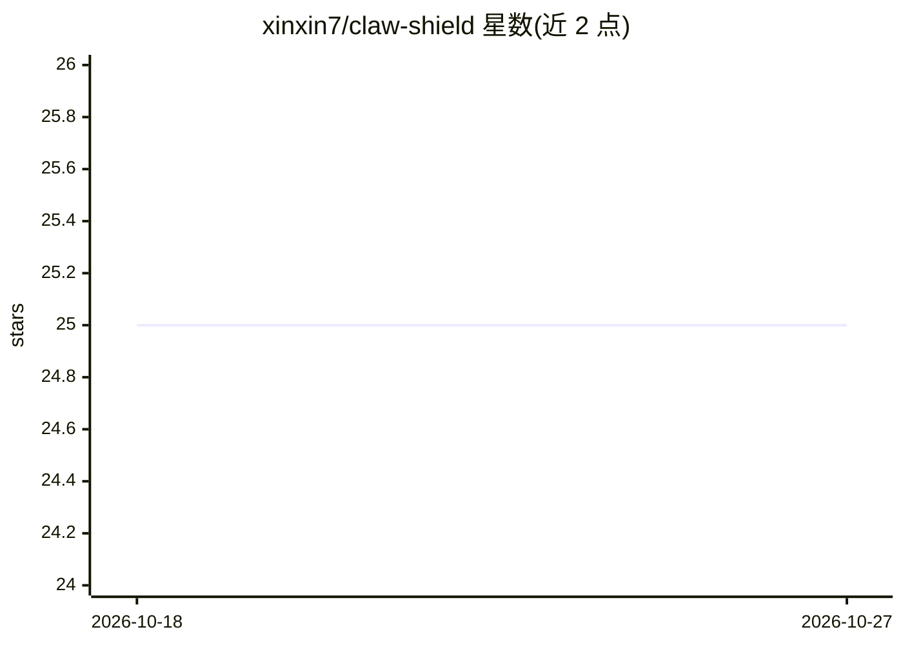

# xinxin7/claw-shield

⭐ 25 · Rust · MIT · 推送 2026-03-11 · [GitHub](https://github.com/xinxin7/claw-shield) · 个人维护

**AI agent 治理层：监控推理链、审计工具调用、拦截高风险操作**

部署在 agent 与外部世界之间的治理与安全层：客户端插件（面向 OpenClaw）拦截出站模型请求，经 OHTTP 中继-网关架构转发到 provider；网关提取推理链（CoT）、工具调用与执行结果的遥测数据，在网关托管的 Dashboard 以三栏瀑布流展示。已交付功能包括 Model-as-a-Judge（第二模型审计高风险操作并拦截）、实时监控与隐私路由；Agent Analytics 与 Self-Profiling API 标注为 coming soon。通过 install.sh 一键安装，需预装 OpenClaw、git、node、npm。

## 筛选速览

| 维度 | 判定 | 备注 |
|---|---|---|
| AI 角色 | `ai-ecosystem` | LLM/agent 周边工具 |
| 许可风险 | `permissive` | MIT |
| 部署形态 | `None` |  |
| 模型依赖 | locked-api |  |
| 硬件要求 | — | 无带数字的原话,不猜 |
| 安装摩擦 | `low` | 无编译、无系统依赖或容器化 |
| 成熟度 | `idea` | |

## 能力要点

- Model-as-a-Judge：第二模型按用户意图审计高风险工具调用，可拒绝执行
- 拦截流式响应中的 reasoning_content，提取逐步推理链与工具调用记录
- OHTTP 中继-网关架构：Relay 看不到内容、网关看不到身份
- 网关托管实时追踪 Dashboard，按项目/会话筛选查看完整推理到动作轨迹

## 适用场景

- 部署 AI agent 前拦截删除文件、危险命令等高风险操作
- 实时查看 agent 的推理过程、决策与执行结果以便审计
- 在访问 LLM provider 时通过 OHTTP 隐藏身份与工具指纹

## 场景标签

`网络安全` `LLM 可观测性` · 领域:评测与运维

## 证据(README 行号)

> L3:  The governance layer for AI agents.
> L20: Claw Shield sits between your agent and the outside world. It captures every chain-of-thought step, every tool call
> L88: 1. **Client plugin** intercepts outbound model requests, wraps them in OHTTP, and injects a `project_id` + `session

## 星数曲线

2026-10-18 25 → 2026-10-27 25（+0）

---
*卡片 v1 · prompt 1.4 · 生成 2026-10-26 · 置信度 high · 依据 README sha `8770eb59a894` · [字段定义](../../DATASET.md)*
