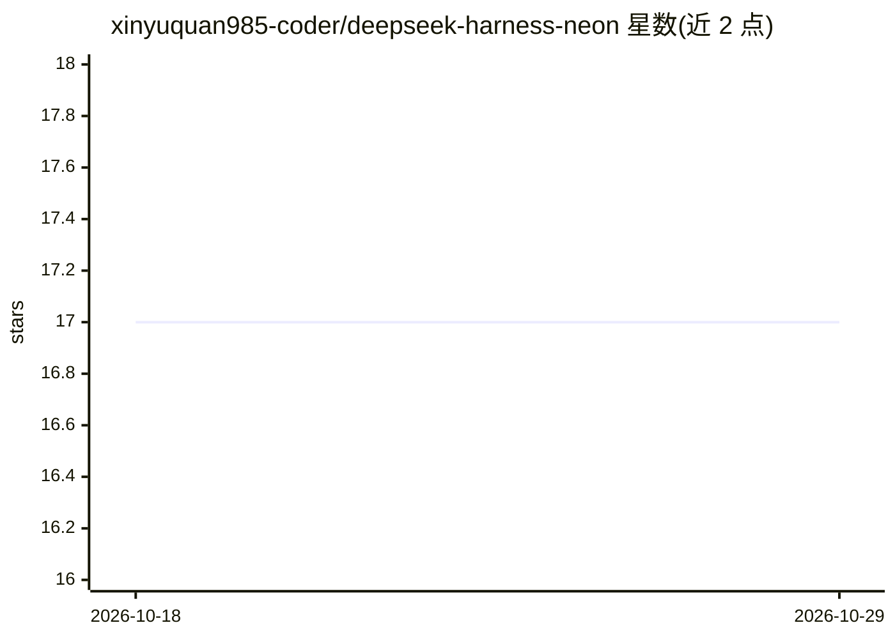

# xinyuquan985-coder/deepseek-harness-neon

⭐ 17 · TypeScript · NOASSERTION · 推送 2026-09-26 · [GitHub](https://github.com/xinyuquan985-coder/deepseek-harness-neon) · 个人维护 · 中文 README

**DeepSeek Harness 的赛博朋克风多 agent 中文界面分支**

DeepSeek Harness 的非官方社区 fork，保留上游插件架构与真实 agent 工作流，新增中文优先的霓虹风界面：对话、代码执行、多 agent 轨迹三个由会话状态自动派生的工作台，以及带参与者/回合/裁判状态的 VS 辩论场，另含语音输入与目标/任务/子 agent 控制栏。Web UI 须经 Harness host 运行，裸 Vite 缺少 window.__DSH_BOOT__。处于 developer preview，接口与配置可能变化。需 Node.js 与 pnpm 从源码构建运行。

## 筛选速览

| 维度 | 判定 | 备注 |
|---|---|---|
| AI 角色 | `ai-ecosystem` | LLM/agent 周边工具 |
| 许可风险 | `none` | NOASSERTION |
| 部署形态 | `library` | 以包/库形式分发 |
| 模型依赖 | — | README 未给出锁定关系 |
| 硬件要求 | — | 无带数字的原话,不猜 |
| 安装摩擦 | `low` | 无编译、无系统依赖或容器化 |
| 成熟度 | `idea` | |

## 能力要点

- 三个由真实会话状态派生的工作台：对话/代码执行/多 agent 轨迹
- VS 辩论场呈现参与者、回合、裁判与子 agent 状态
- 中文优先界面，含语音输入与启动音频
- 保留上游 DeepSeek Harness 插件架构，运行时基于 Cordis

## 适用场景

- 为 DeepSeek Harness 换用中文优先的赛博朋克风操作界面
- 观察与检查多 agent 会话的轨迹、审批与产出文件
- 以辩论场形式运行多 agent 对决工作流

## 场景标签

`多智能体` · 领域:Agent 开发

## 证据(README 行号)

> L9: Neon Harness is a cyberpunk multi-agent command center for DeepSeek Harness. It keeps the upstream plugin architectu
> L13: - Three workbenches derived automatically from real session state: conversation, code execution, and multi-agent tr

## 星数曲线

2026-10-18 17 → 2026-10-29 17（+0）

---
*卡片 v1 · prompt 1.4 · 生成 2026-10-29 · 置信度 mid · 依据 README sha `650e533095ee` · [字段定义](../../DATASET.md)*
