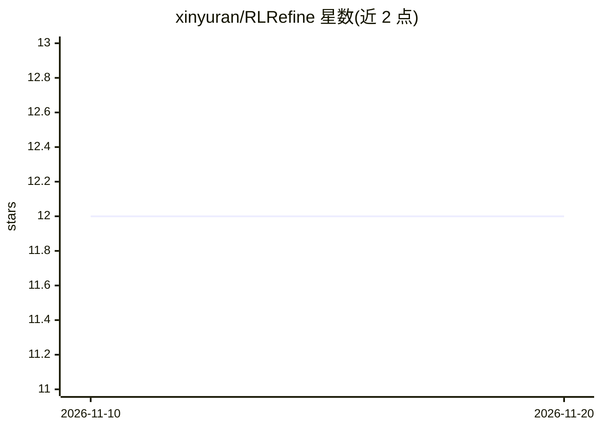

# xinyuran/RLRefine

⭐ 12 · Python · MIT · 推送 2026-11-11 · [GitHub](https://github.com/xinyuran/RLRefine) · [官网](https://huggingface.co/spaces/xinyuran/RLRefine-Demo) · 个人维护 · 中文 README

**中文评论关键词抽取的 Schema 驱动 LLM 抽取与后训练工具包**

Python 工具包，围绕中文电商评论关键词抽取示例提供：任务 Schema 与 JSON Schema 导出、基于源文本子串的输出契约校验、OpenAI 兼容端点推理管道（重试/回退/错误态），以及 LoRA SFT→DPO→GRPO 后训练脚本与奖励设计。发布 Qwen2.5-7B 微调模型与合成数据集于 Hugging Face，浏览器 demo 使用 ZeroGPU 共享推理。README 明示历史部署门槛未通过、英文任务与跨领域泛化未验证、完整冻结评测集未公开。

## 筛选速览

| 维度 | 判定 | 备注 |
|---|---|---|
| AI 角色 | `ai-native` | 本体是模型或模型工具 |
| 许可风险 | `permissive` | MIT |
| 部署形态 | `library` | 以包/库形式分发 |
| 模型依赖 | local-ok | 支持本地模型 |
| 硬件要求 | — | 无带数字的原话,不猜 |
| 安装摩擦 | `medium` | 含编译或系统依赖之一 |
| 成熟度 | `idea` | |

## 能力要点

- 任务 Schema/关键词契约校验（源子串、置信度、数量、去重检查）
- SFT→DPO→GRPO 后训练脚本及结构/来源/参考奖励
- 331 开发样本与 494/496 人工复核样本的阶段化评测数字
- 离线确定性修复使 Schema validity 达 1.0（开发集历史结果）

## 适用场景

- 对中文电商评论做结构化关键词抽取
- 为 schema 约束的 LLM 抽取任务搭建校验管道
- 复现 SFT/DPO/GRPO 训练与评测流程

## 场景标签

`微调` `强化学习` `模型评测` · 领域:评测与运维

## 证据(README 行号)

> L14: RLRefine is a Python toolkit for structured LLM extraction, with Chinese
> L16: inference validation and SFT → DPO → GRPO rewards, so you can inspect both
> L58: |Post-training recipes|LoRA SFT, DPO and GRPO scripts with structure/source/reference-based rewards|

## 星数曲线

2026-11-10 12 → 2026-11-20 12（+0）

---
*卡片 v1 · prompt 1.4 · 生成 2026-11-18 · 置信度 high · 依据 README sha `03be3dc83baf` · [字段定义](../../DATASET.md)*
