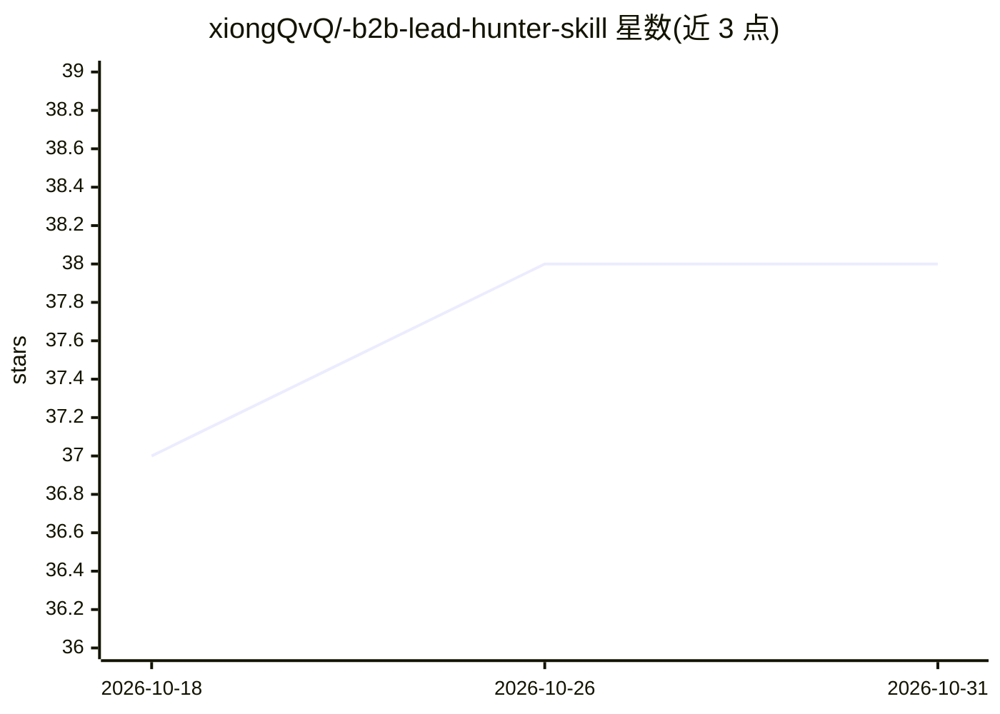

# xiongQvQ/-b2b-lead-hunter-skill

⭐ 38 · Python · MIT · 推送 2026-10-29 · [GitHub](https://github.com/xiongQvQ/-b2b-lead-hunter-skill) · [官网](https://b2binsights.io/) · 个人维护 · 中文 README

**外贸 B2B 客户挖掘的 AI Agent 技能包：跑在四平台内自动化线索研究**

一个 AI Agent Skill（非独立应用），需运行在 Claude Code、Cursor、Cline 或 Hermes 之内，为外贸出口团队自动化 B2B 线索研究：多路搜索、网站阅读、联系人提取、评分、决策人挖掘、海关信号核查、开发信草拟与受控 SMTP 发送。采用 AI 负责策略判断、18 个 Python 脚本负责确定性处理的分离架构，各阶段 JSONL schema 校验；发送有哈希锁定、抑制名单、退订执行等合规门槛。要求 Python 3.10+，部分功能需可选 API key（Jina/Serper/Tavily/SMTP）。

## 筛选速览

| 维度 | 判定 | 备注 |
|---|---|---|
| AI 角色 | `ai-ecosystem` | LLM/agent 周边工具 |
| 许可风险 | `permissive` | MIT |
| 部署形态 | `library` | 以包/库形式分发 |
| 模型依赖 | locked-api |  |
| 硬件要求 | — | 无带数字的原话,不猜 |
| 安装摩擦 | `low` | 无编译、无系统依赖或容器化 |
| 成熟度 | — | 结构信号不足 |

## 能力要点

- 覆盖产品简报→搜索→提取→评分→决策人→海关信号→草拟→评估→发送的完整流水线
- 18 个 Python 脚本（4,872 行）承担确定性转换，各阶段经 contracts.py schema 校验
- 哈希锁定发送门槛、抑制名单、退订执行等合规机制
- 一套技能适配 Claude Code / Cursor / Cline / Hermes 四个 agent 平台

## 适用场景

- 外贸销售团队挖掘可溯源的海外买家线索与决策人
- 在 Claude Code 等 agent 内自动化开发信撰写与受控发送
- 核查潜客的海关/进口信号并生成个性化开发信草稿

## 场景标签

`网页抓取` · 领域:效率与自动化

## 证据(README 行号)

> L12: **An AI Agent Skill — not a standalone app.** It runs inside Claude Code, Cursor, Cline, or Hermes to automate fore
> L25: |2|**Multi-Platform**|One skill runs on **Claude Code**, **Cursor**, **Cline**, and **Hermes**. Platform-specific f

## 星数曲线

2026-10-18 37 → 2026-10-31 38（+1）

---
*卡片 v1 · prompt 1.4 · 生成 2026-10-25 · 置信度 mid · 依据 README sha `6c051f8611e6` · [字段定义](../../DATASET.md)*
