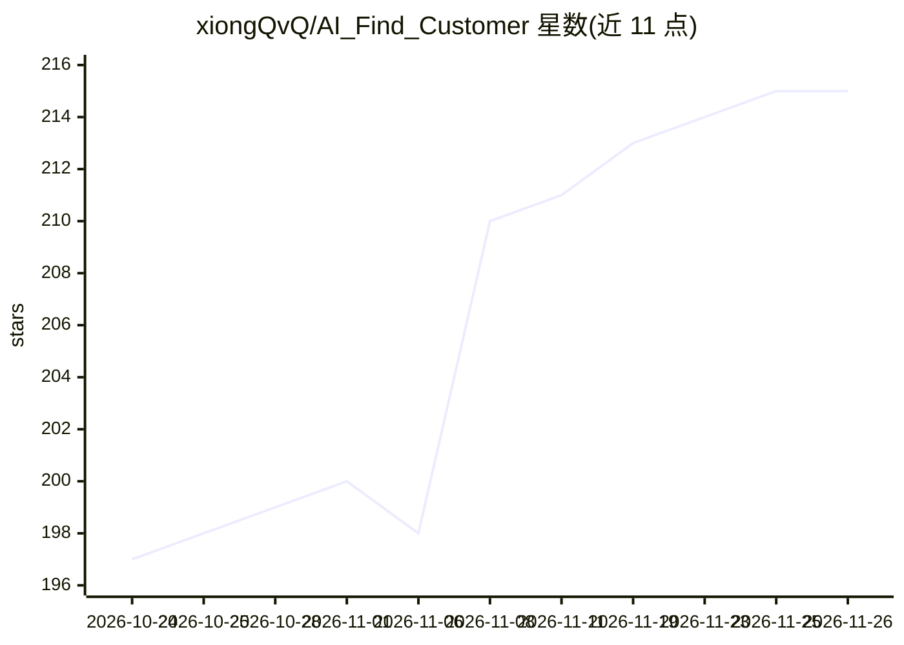

# xiongQvQ/AI_Find_Customer

⭐ 215 · Python · MIT · 推送 2026-11-05 · [GitHub](https://github.com/xiongQvQ/AI_Find_Customer) · [官网](https://b2binsights.io/) · 个人维护 · 中文 README

**面向外贸与 B2B 场景的 AI 客户挖掘与开发信发送系统**

基于 FastAPI、LangGraph 与 React 的自动化客户挖掘系统：用户提供公司官网、产品文档或关键词，多 Agent 流水线（Insight→KeywordGen→Search→LeadExtract→Evaluate）依次完成公司理解、关键词生成、网页搜索、线索提取与联系方式发现；另支持生成 3 步开发信序列、人工审批后经 SMTP 自动发送并做 IMAP 回信检测。任务队列与邮件发送队列基于 SQLite 持久化，支持 producer/consumer 无界面部署、状态监控接口与飞书通知。运行需自备 LLM 与搜索 API Key；license-server 等模块不在公开仓库内。

## 筛选速览

| 维度 | 判定 | 备注 |
|---|---|---|
| AI 角色 | `ai-native` | 本体是模型或模型工具 |
| 许可风险 | `permissive` | MIT |
| 部署形态 | `None` |  |
| 模型依赖 | — | README 未给出锁定关系 |
| 硬件要求 | — | 无带数字的原话,不猜 |
| 安装摩擦 | `low` | 无编译、无系统依赖或容器化 |
| 成熟度 | — | 结构信号不足 |

## 能力要点

- 多 Agent 流水线：公司理解→关键词生成→搜索→线索提取→评估
- 双模型协作：推理模型负责 ReAct 决策，普通模型负责抽取与生成
- 经 LiteLLM 可接入 OpenAI、Anthropic、OpenRouter、Groq、GLM、Moonshot、MiniMax
- 邮件链路含模板种子、人工审批、campaign 自动发送与回信检测

## 适用场景

- 从官网和产品关键词出发批量挖掘海外客户线索与联系方式
- 自动生成开发信序列并经人工审批后定时发送
- 在 VPS 上以 producer/consumer 模式 7x24 持续跑获客任务
- 通过飞书机器人接收挖掘进度与异常告警

## 场景标签

 · 领域:企业服务/销售与营销

## 证据(README 行号)

> L10: AI Hunter 是一个面向外贸与 B2B 线索挖掘场景的开源版项目。你只需要提供公司官网、产品文档或产品关键词，再指定目标市场，系统就会自动完成公司理解、关键词生成、网页搜索、线索提取和联系方式发现。
> L54: - 多 Agent 流水线：`Insight -> KeywordGen -> Search -> LeadExtract -> Evaluate`
> L65: - 可替换模型：统一通过 LiteLLM 接入 OpenAI、Anthropic、OpenRouter、Groq、GLM、Moonshot、MiniMax

## 星数曲线

2026-10-24 197 → 2026-11-26 215（+18）

---
*卡片 v1 · prompt 1.4 · 生成 2026-11-25 · 置信度 high · 依据 README sha `7658c5f8d0ff` · [字段定义](../../DATASET.md)*
