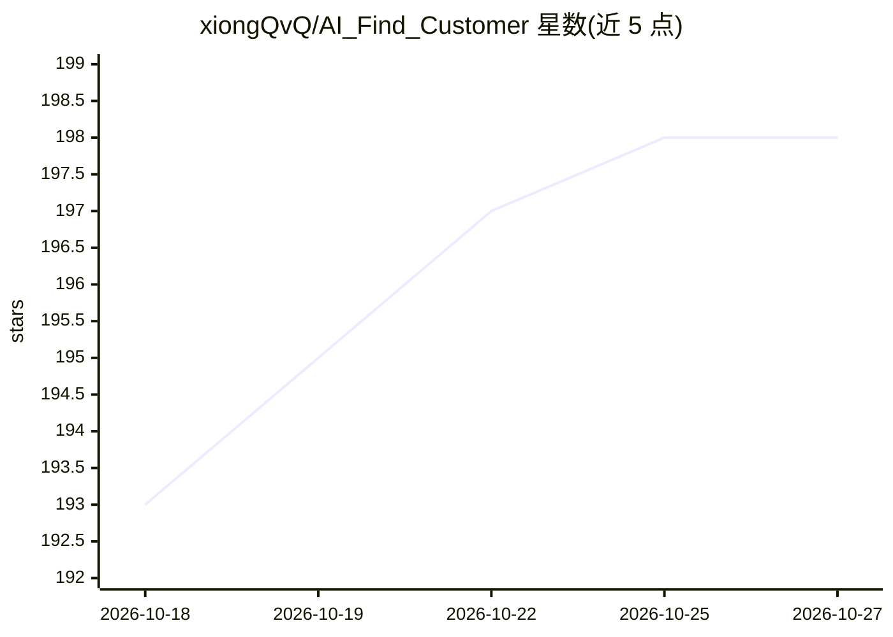

# xiongQvQ/AI_Find_Customer

⭐ 198 · Python · MIT · 推送 2026-07-17 · [GitHub](https://github.com/xiongQvQ/AI_Find_Customer) · [官网](https://b2binsights.io/) · 个人维护 · 中文 README

**外贸 B2B 场景的 AI 客户挖掘与开发信自动化系统**

基于 FastAPI、LangGraph 与 React 的多 Agent 流水线：输入官网、文档或关键词后，自动完成公司理解（Insight）、关键词生成（KeywordGen）、多通道网页搜索、线索提取（LeadExtract）与评估（Evaluate），并提取邮箱、电话、社媒等联系方式；支持基于 ICP 与历史邮件样例生成 3 步开发信序列，经人工审核后创建 campaign 由 scheduler 自动发送并检测回信。模型统一经 LiteLLM 接入 OpenAI、Anthropic、OpenRouter、Groq、MiniMax 等，推荐 MiniMax 起步。邮件依赖自配 SMTP/IMAP；开源仓库不含 license-server 与 landing 等模块，另有商业产品 B2Binsights。

## 筛选速览

| 维度 | 判定 | 备注 |
|---|---|---|
| AI 角色 | `ai-native` | 本体是模型或模型工具 |
| 许可风险 | `permissive` | MIT |
| 部署形态 | `None` |  |
| 模型依赖 | — | README 未给出锁定关系 |
| 硬件要求 | — | 无带数字的原话,不猜 |
| 安装摩擦 | `low` | 无编译、无系统依赖或容器化 |
| 成熟度 | — | 结构信号不足 |

## 能力要点

- 五阶段多 Agent 流水线：Insight→KeywordGen→Search→LeadExtract→Evaluate
- 通过 LiteLLM 接入 OpenAI、Anthropic、OpenRouter、Groq、GLM、Moonshot、MiniMax 等多模型
- SQLite 两层持久化队列（hunt_jobs / email_messages）支持 7x24 无界面 producer/consumer 运行
- AI 生成 3 步开发信序列，支持人工审核、campaign 自动发送与 IMAP 回信检测
- 飞书通知（任务失败/新增企业/邮件已发送/周期汇总）与自动化状态监控接口

## 适用场景

- 外贸业务输入自己官网与产品关键词，自动挖出目标市场的潜在客户与决策人联系方式
- 基于官网洞察和历史邮件样例批量生成并自动发送开发信序列
- 在 VPS 上无界面长期运行客户挖掘与邮件外发流水线

## 场景标签

`多智能体` `网页抓取` · 领域:Agent 开发

## 证据(README 行号)

> L10: AI Hunter 是一个面向外贸与 B2B 线索挖掘场景的开源版项目。你只需要提供公司官网、产品文档或产品关键词，再指定目标市场，系统就会自动完成公司理解、关键词生成、网页搜索、线索提取和联系方式发现。
> L56: - 多 Agent 流水线：`Insight -> KeywordGen -> Search -> LeadExtract -> Evaluate`
> L67: - 可替换模型：统一通过 LiteLLM 接入 OpenAI、Anthropic、OpenRouter、Groq、GLM、Moonshot、MiniMax

## 星数曲线

2026-10-18 193 → 2026-10-27 198（+5）

---
*卡片 v1 · prompt 1.4 · 生成 2026-10-22 · 置信度 high · 依据 README sha `57aa5c0332e5` · [字段定义](../../DATASET.md)*
