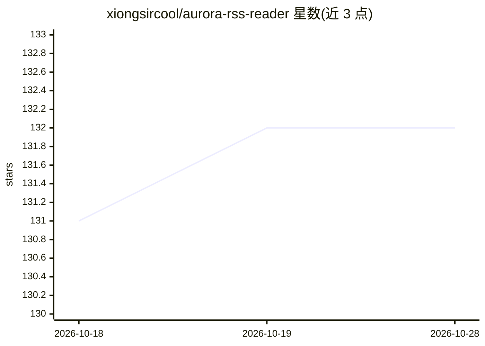

# xiongsircool/aurora-rss-reader

⭐ 132 · Dart · GPL-3.0 · 推送 2026-10-19 · [GitHub](https://github.com/xiongsircool/aurora-rss-reader) · [官网](https://rss.526339.xyz) · 个人维护 · 中文 README

**AI 增强的跨平台 RSS 阅读器，支持摘要与多语言翻译**

同一仓库提供两个客户端：Electron + Vue 3 + Fastify 桌面版（v0.2.0，Windows/macOS/Linux 安装包，SQLite 本地存储）与 Flutter 本地优先移动版（v0.1.2，Android APK，无账号无服务器无遥测）。AI 能力包括文章摘要、全文与标题多语言翻译、后台摘要队列、MCP 设置与 Zotero 集成，用户使用自有 API key（SiliconFlow/DeepSeek）。支持 RSS 1.0/2.0、Atom、Media RSS、播客解析，FTS5 全文搜索、OPML 导入导出、RSSHub 配置与阅读统计。提供源码运行与 Docker（linux/amd64）部署方式；macOS 构建未签名，需手动处理 quarantine。

## 筛选速览

| 维度 | 判定 | 备注 |
|---|---|---|
| AI 角色 | `ai-enhanced` | 去掉 AI 部分产品仍成立 |
| 许可风险 | `viral` | GPL-3.0 |
| 部署形态 | `desktop` | 安装包/桌面程序 |
| 模型依赖 | — | README 未给出锁定关系 |
| 硬件要求 | — | 无带数字的原话,不猜 |
| 安装摩擦 | `low` | 无编译、无系统依赖或容器化 |
| 成熟度 | — | 结构信号不足 |

## 能力要点

- 桌面版与 Flutter 移动版双客户端，数据本地 SQLite 存储
- AI 摘要与双语全文/标题翻译（用户自有 API key）
- 后台摘要队列持久化并在重启后复用
- RSS/Atom/Media RSS/播客多格式解析，FTS5 搜索与 OPML 迁移

## 适用场景

- 订阅并阅读 RSS/播客内容，获得 AI 摘要与翻译辅助
- 无账号本地优先地在移动端管理订阅
- 借助 RSSHub 扩展订阅源覆盖范围

## 场景标签

`AI 写作` · 领域:内容生成

## 证据(README 行号)

> L43: - 🤖 AI with your own key (SiliconFlow / DeepSeek) — summaries, bilingual full-text translation, live title translat
> L65: Aurora RSS Reader is a cross-platform desktop RSS reader integrated with AI translation and summarization features.
> L79: - **Article Summaries** - Automatically generate key points for quick understanding

## 星数曲线

2026-10-18 131 → 2026-10-28 132（+1）

---
*卡片 v1 · prompt 1.4 · 生成 2026-10-22 · 置信度 mid · 依据 README sha `1024e7e1646b` · [字段定义](../../DATASET.md)*
