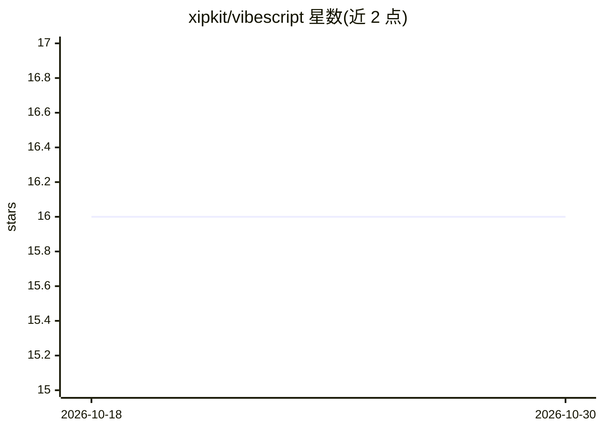

# xipkit/vibescript

⭐ 16 · Rust · MIT · 推送 2026-10-29 · [GitHub](https://github.com/xipkit/vibescript) · [官网](https://vibescript-lang.org) · 个人维护

**面向 AI 编写的可嵌入静态类型脚本语言（Rust 实现）**

用 Rust 实现的小型静态类型脚本语言，定位为宿主应用之上的定制脚本层：宿主决定脚本可访问的能力与资源上限，类型检查器在执行前捕获错误并在诊断中给出修复建议，供人与 AI 编写自定义行为。提供 CLI、REPL、格式化器、测试运行器与语言服务器，支持 WASI 目标，可通过 vibescript crate 嵌入 Rust 应用并暴露类型化宿主函数；CI 在 Linux x86_64 与 macOS arm64 上运行金样本测试与 SIMD/可移植构建比对，另有模糊测试。语法受 Ruby 启发。

## 筛选速览

| 维度 | 判定 | 备注 |
|---|---|---|
| AI 角色 | `ai-ecosystem` | LLM/agent 周边工具 |
| 许可风险 | `permissive` | MIT |
| 部署形态 | `None` |  |
| 模型依赖 | — | README 未给出锁定关系 |
| 硬件要求 | — | 无带数字的原话,不猜 |
| 安装摩擦 | `low` | 无编译、无系统依赖或容器化 |
| 成熟度 | — | 结构信号不足 |

## 能力要点

- 静态类型检查在执行前捕获错误并在诊断中提供修复建议
- 宿主控制脚本能力与每次运行的资源限制
- CLI、REPL、格式化器、测试运行器、语言服务器随项目提供
- 可通过 crate 嵌入 Rust 应用并暴露类型化宿主函数；支持 WASI

## 适用场景

- 在我的应用里嵌入脚本层，让用户或 AI 安全地写定制逻辑
- 给 AI 作者提供语言参考与 prelude 签名以生成可校验的脚本
- 在 WASI 环境运行脚本或做跨平台校验

## 场景标签

 · 领域:编程语言/开发工具

## 证据(README 行号)

> L11: Vibescript helps power this future with a small, statically typed scripting
> L63: Give an AI author `vibescript::guide()` for the language reference and

## 星数曲线

2026-10-18 16 → 2026-10-30 16（+0）

---
*卡片 v1 · prompt 1.4 · 生成 2026-10-30 · 置信度 high · 依据 README sha `59cd864473b9` · [字段定义](../../DATASET.md)*
