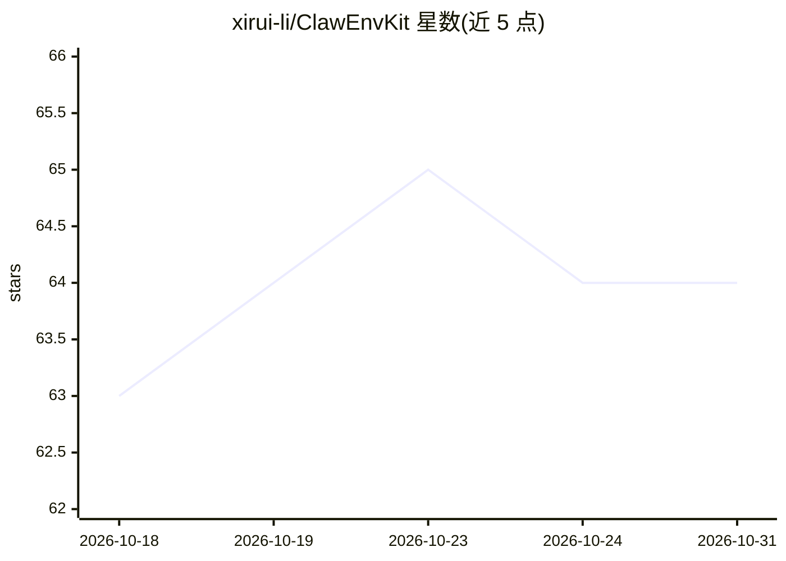

# xirui-li/ClawEnvKit

⭐ 64 · Python · MIT · 推送 2026-05-07 · [GitHub](https://github.com/xirui-li/ClawEnvKit) · [官网](https://huggingface.co/papers/2604.18543) · 组织维护

**为 claw 类 agent 自动生成训练/评测环境的工具包**

面向 OpenClaw、Claude Code、NanoClaw 等 claw 类 agent 的环境生成与评测工具包：从自然语言自动生成 task.yaml 训练/评测环境（含 prompt、fixtures、工具、评分标准与安全检查），并提供 15 种结构化检查类型、20 个 mock API 服务、审计日志验证与 0.0-1.0 连续评分。支持 10 种评测 harness（原生插件/MCP/SKILL.md+shell 三层）及无 Docker 的 Agent Loop 基线。需 Python 3.10+ 与 Docker/Colima，安装要求源码 checkout（pip install -e .），生成功能需 OpenRouter 或 Anthropic/OpenAI API key。附 HuggingFace 预生成数据集与 GHCR 预构建镜像。

## 筛选速览

| 维度 | 判定 | 备注 |
|---|---|---|
| AI 角色 | `ai-ecosystem` | LLM/agent 周边工具 |
| 许可风险 | `permissive` | MIT |
| 部署形态 | `self-host` | docker 或自建部署 |
| 模型依赖 | locked-api |  |
| 硬件要求 | — | 无带数字的原话,不猜 |
| 安装摩擦 | `low` | 无编译、无系统依赖或容器化 |
| 成熟度 | — | 结构信号不足 |

## 能力要点

- 自然语言自动生成完整 task.yaml 评测环境（prompt/fixtures/工具/评分标准/安全检查）
- 15 种结构化检查 + 2 种安全检查，审计日志验证与 0.0-1.0 连续评分（safety×(0.8×completion+0.2×robustness)）
- 支持 10 种评测 harness，三层集成：原生插件（OpenClaw）/MCP/SKILL.md+shell
- 20 个 mock 服务（email/scheduling/CRM/finance/OCR 等），支持错误注入与跨服务组合

## 适用场景

- 为 claw 类 agent 自动生成训练与评测环境，替代手工编写任务
- 用预生成基准数据集（Auto-ClawEval）在 Docker 中评测多种 agent
- 为自有领域按需生成 mock 服务与跨服务基准任务

## 场景标签

`模型评测` · 领域:评测与运维

## 证据(README 行号)

> L23: > **ClawEnvKit** is an open-source environment generation toolkit for claw-like agents (OpenClaw, NanoClaw, etc.). 
> L33: - **No hand-written tests** — LLM generates YAML configs, a fixed engine handles verification
> L153: ClawEnvKit supports three integration tiers: native plugin for OpenClaw, MCP servers for Claude Code, NanoClaw, Ir

## 星数曲线

2026-10-18 63 → 2026-10-31 64（+1）

---
*卡片 v1 · prompt 1.4 · 生成 2026-10-24 · 置信度 mid · 依据 README sha `f5ccf194599d` · [字段定义](../../DATASET.md)*
