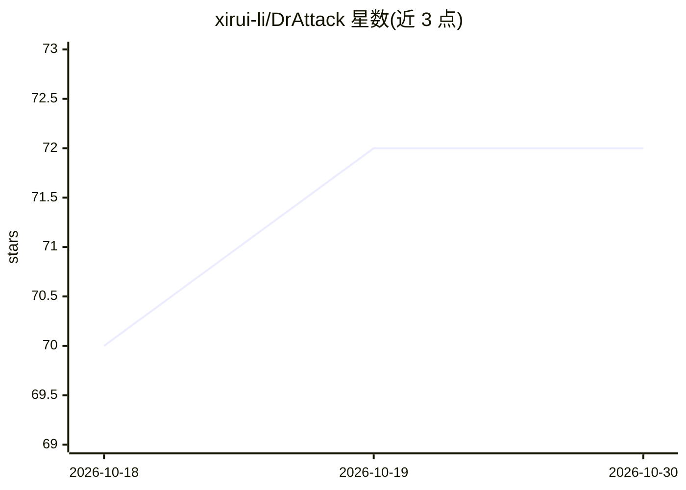

# xirui-li/DrAttack

⭐ 72 · JavaScript · MIT · 推送 2026-09-12 · [GitHub](https://github.com/xirui-li/DrAttack) · [官网](https://xirui-li.github.io/DrAttack/) · 组织维护

**论文官方实现：通过提示分解重构对 LLM 实施越狱攻击**

DrAttack 论文的官方代码与数据仓库，实现一种提示分解式越狱攻击方法，含三个组件：将原提示分解为子提示、通过上下文学习用语义相似但无害的重组示例隐式重构、对子提示做同义词搜索以保持原意同时绕过 LLM 安全限制。支持对开源模型（Vicuna、Llama2-7b/13b）与闭源 API 模型（GPT-3.5、GPT-4、Gemini-pro）在 AdvBench 数据集上复现攻击实验，附自动化脚本与 Colab 演示 notebook。论文报告在 GPT-4 上以 15 次查询达到 78.0% 成功率。

## 筛选速览

| 维度 | 判定 | 备注 |
|---|---|---|
| AI 角色 | `ai-ecosystem` | LLM/agent 周边工具 |
| 许可风险 | `permissive` | MIT |
| 部署形态 | `library` | 以包/库形式分发 |
| 模型依赖 | — | README 未给出锁定关系 |
| 硬件要求 | — | 无带数字的原话,不猜 |
| 安装摩擦 | `low` | 无编译、无系统依赖或容器化 |
| 成熟度 | — | 结构信号不足 |

## 能力要点

- 提示分解（Decomposition）+ 重构（Reconstruction）+ 同义词搜索三组件攻击方法
- 支持开源模型（Vicuna/Llama2）与闭源 API（GPT-3.5/GPT-4/Gemini）
- 在 AdvBench harmful 数据集上复现攻击实验的脚本
- 提供 Colab 演示 notebook（最小实现，用于熟悉算法）

## 适用场景

- 复现论文中的 LLM 越狱攻击实验
- 评估 LLM 对提示分解类攻击的安全性与鲁棒性
- 学习攻击算法的最小实现（demo notebook）

## 场景标签

`网络安全` · 领域:学习与行业

## 证据(README 行号)

> L17: ## 🔍 About DrAttack
> L58: The `experiments` folder contains code to reproduce DrAttack attack experiments on AdvBench harmful.

## 星数曲线

2026-10-18 70 → 2026-10-30 72（+2）

---
*卡片 v1 · prompt 1.4 · 生成 2026-10-24 · 置信度 high · 依据 README sha `633fc76cb978` · [字段定义](../../DATASET.md)*
