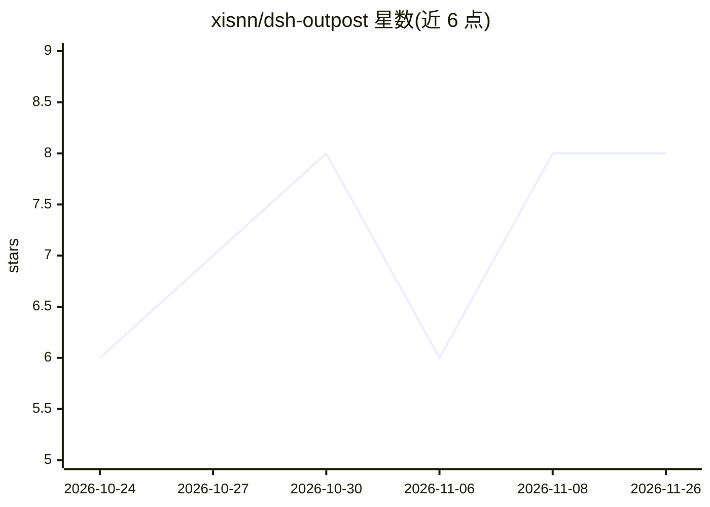

# xisnn/dsh-outpost

⭐ 8 · JavaScript · MIT · 推送 2026-11-22 · [GitHub](https://github.com/xisnn/dsh-outpost) · 个人维护

**DeepSeek Harness 的非官方手机与桌面客户端**

第三方客户端，连接用户自己电脑上运行的 DeepSeek Harness（DSH）服务，不包含、不分发 DSH 本体。包含两部分：Android 原生 App（查看会话、流式聊天、Markdown 渲染、附件上传、手机端审批授权、系统通知、凭据存 Keystore、重试复用幂等键防止任务重复执行）和 Windows 托盘桌面助手（扫码配对、管理隧道、IP 变更自动修复）。支持局域网直连、Tailscale、Cloudflare 隧道三种连接方式；管家模式依赖 DSH 的 Agent Teams profile。仅支持 Android，协议为逆向所得、无版本协商。

## 筛选速览

| 维度 | 判定 | 备注 |
|---|---|---|
| AI 角色 | `ai-ecosystem` | LLM/agent 周边工具 |
| 许可风险 | `permissive` | MIT |
| 部署形态 | `desktop` | 安装包/桌面程序 |
| 模型依赖 | locked-api |  |
| 硬件要求 | — | 无带数字的原话,不猜 |
| 安装摩擦 | `low` | 无编译、无系统依赖或容器化 |
| 成熟度 | — | 结构信号不足 |

## 能力要点

- Android App + Windows 托盘桌面助手两种客户端形态
- 凭据存系统级加密存储，重试复用幂等键防任务重复执行
- 手机端审批（拒绝/允许一次）与推送通知
- 局域网 / Tailscale / Cloudflare 隧道三种连接方式

## 适用场景

- 在手机上查看和操作电脑上运行的 DSH 会话
- 不在电脑前时用手机审批 Agent 的授权请求
- 外出时通过 Tailscale 或隧道远程连接家中电脑

## 场景标签

`编码 Agent` · 领域:编码与开发

## 证据(README 行号)

> L18: > ⚠️ 本项目是第三方客户端，**不隶属于 DeepSeek**。它连的是你自己电脑上运行的 DSH 服务，
> L19: > 不包含、也不分发 DSH 本体。

## 星数曲线

2026-10-24 6 → 2026-11-26 8（+2）

---
*卡片 v1 · prompt 1.4 · 生成 2026-11-20 · 置信度 high · 依据 README sha `0ad6274e97f1` · [字段定义](../../DATASET.md)*
