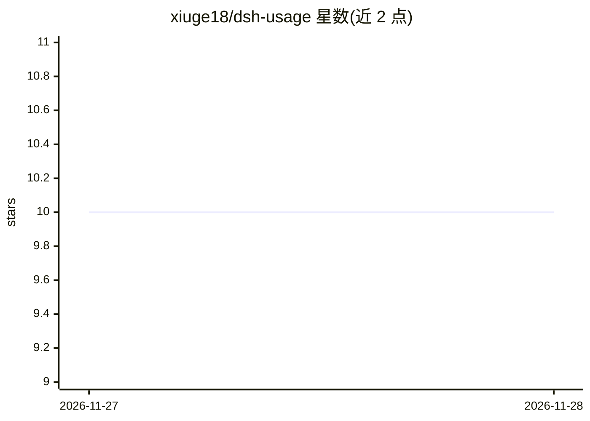

# xiuge18/dsh-usage

⭐ 10 · C# · MIT · 推送 2026-11-26 · [GitHub](https://github.com/xiuge18/dsh-usage) · 个人维护 · 中文 README

**给 DeepSeek Harness 用户统计本机会话 token 用量与花费的桌面工具**

读取 DeepSeek Harness 保存在 ~/.dsh 下的本地会话记录，按会话、子智能体、时段、闲时/高峰分别汇总 token 用量与估算花费，支持多选合计、多会话对比、逐轮明细与 CSV 导出。工具只读不写、不联网；按请求时刻套用官方单价做估算，与官方账单存在几个百分点差异；默认单价取 deepseek-flash，可在设置中修改。Windows 单文件 exe，双击即用，也可用 csc.exe 工具链自行编译。

## 筛选速览

| 维度 | 判定 | 备注 |
|---|---|---|
| AI 角色 | `ai-ecosystem` | LLM/agent 周边工具 |
| 许可风险 | `permissive` | MIT |
| 部署形态 | `desktop` | 安装包/桌面程序 |
| 模型依赖 | — | README 未给出锁定关系 |
| 硬件要求 | — | 无带数字的原话,不猜 |
| 安装摩擦 | `low` | 无编译、无系统依赖或容器化 |
| 成熟度 | — | 结构信号不足 |

## 能力要点

- 按闲时/高峰、命中/未命中输入/输出分别累加计价的估算机制
- 只读本地记录，不联网、不写入 dsh 文件
- 单 exe 双击运行，冷启动解析上百会话约 70ms 并走增量缓存
- 支持多会话对比、按天双图与 CSV 导出

## 适用场景

- 统计本机 dsh 会话一共跑了多少 token、折成多少钱
- 分析用量集中在闲时还是高峰
- 导出 CSV 做 Excel 进一步分析

## 场景标签

`LLM 可观测性` · 领域:评测与运维

## 证据(README 行号)

> L5:  统计本机 DeepSeek Harness（dsh） 会话的 token 用量 与 花费 ：一共跑了多少量、折成多少钱、花在闲时还是高峰。
> L15: DSH记账 就是把这些本地记录读出来做汇总：按会话、按子智能体、按时间段、按闲时/高峰分别统计，能做多选对比，也能导出 CSV。
> L17: 界面是原生 WinForms 自绘，没有 Web 内核、没有 Electron，单个 exe 双击就跑，冷启动解析上百个会话大约 70ms，之后走增量缓存。

## 星数曲线

2026-11-27 10 → 2026-11-28 10（+0）

---
*卡片 v1 · prompt 1.4 · 生成 2026-11-27 · 置信度 high · 依据 README sha `6cfefa2d792d` · [字段定义](../../DATASET.md)*
