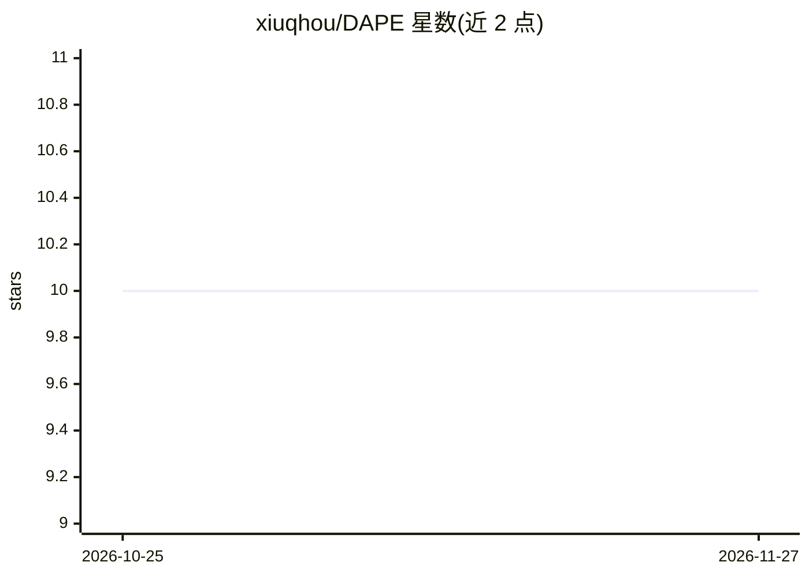

# xiuqhou/DAPE

⭐ 10 · Python · Apache-2.0 · 推送 2026-01-16 · [GitHub](https://github.com/xiuqhou/DAPE) · 组织维护

**检测与全任务分割的视觉预测模型实现（论文官方代码）**

AAAI2026 论文 DAPE 的官方实现，提供目标检测、实例分割、语义分割与全景分割的统一架构。仓库给出 Model Zoo（COCO/Cityscapes 上 ResNet50 backbone 的 config 与 checkpoint 下载）、安装步骤（git clone、pip 安装 PyTorch 与 requirements）、COCO/LVIS/Cityscapes 数据集准备方式，以及基于 accelerate 的训练与评估脚本。核心机制包括协调内容与位置分布的 Harmonized Sampling，以及通过低秩位置编码器降低训练显存占用。

## 筛选速览

| 维度 | 判定 | 备注 |
|---|---|---|
| AI 角色 | `ai-native` | 本体是模型或模型工具 |
| 许可风险 | `permissive` | Apache-2.0 |
| 部署形态 | `desktop` | 安装包/桌面程序 |
| 模型依赖 | — | README 未给出锁定关系 |
| 硬件要求 | — | 无带数字的原话,不猜 |
| 安装摩擦 | `medium` | 含编译或系统依赖之一 |
| 成熟度 | — | 结构信号不足 |

## 能力要点

- 统一架构覆盖目标检测与语义/实例/全景分割
- 低秩位置编码器降低训练显存占用
- 提供 COCO 与 Cityscapes 上的 config 与预训练权重下载
- 基于 accelerate 的多 GPU 训练与评估脚本

## 适用场景

- 复现论文的目标检测与分割实验结果
- 在 COCO/Cityscapes 上训练检测与分割模型
- 下载预训练权重直接评估检测与分割性能

## 场景标签

`目标检测` · 领域:感知与多模态

## 证据(README 行号)

> L5: This repo is the official implementation of **DAPE: Harmonizing Content-Position Encoding for Versatile Dense Visual
> L13: - **Unified Architecture**: One architecture for detection and all-in-one segmentation (semantic/instance/panoptic)

## 星数曲线

2026-10-25 10 → 2026-11-27 10（+0）

---
*卡片 v1 · prompt 1.4 · 生成 2026-11-19 · 置信度 high · 依据 README sha `4bfb69880b21` · [字段定义](../../DATASET.md)*
