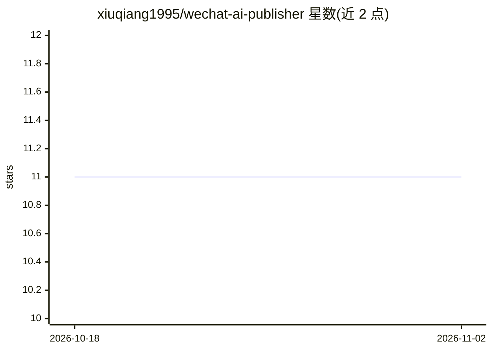

# xiuqiang1995/wechat-ai-publisher

⭐ 11 · Python · MIT · 推送 2026-02-03 · [GitHub](https://github.com/xiuqiang1995/wechat-ai-publisher) · 个人维护 · 中文 README

**微信公众号文章自动化发布工具链：AI 写作配图到草稿箱一键发布**

覆盖写作→人性化改写→配图规划→生图→回填→HTML 渲染→草稿箱发布的完整工作流：基于主题和素材生成公众号文章，分析内容自动规划配图并经 Replicate API（FLUX.1 [dev]/Stable Diffusion 等）生成图片，按内容关键词自动匹配 CSS 样式与配图风格，渲染 HTML 后通过微信公众号 API 上传至草稿箱。面向内容创作者，需 Python 3.9+、Node.js 16+、公众号开发者账号与 Replicate API Token，从源码安装运行，macOS/Linux 推荐。

## 筛选速览

| 维度 | 判定 | 备注 |
|---|---|---|
| AI 角色 | `ai-native` | 本体是模型或模型工具 |
| 许可风险 | `permissive` | MIT |
| 部署形态 | `library` | 以包/库形式分发 |
| 模型依赖 | — | README 未给出锁定关系 |
| 硬件要求 | — | 无带数字的原话,不猜 |
| 安装摩擦 | `low` | 无编译、无系统依赖或容器化 |
| 成熟度 | — | 结构信号不足 |

## 能力要点

- 主题/素材到发布的九步自动化工作流
- 基于 Replicate API 的封面与配图批量生成
- 多种 CSS 样式与配图风格，按文章内容自动匹配
- 微信公众号草稿箱一键发布

## 适用场景

- 我运营公众号，想从选题直接产出配好图的文章并推到草稿箱
- 我写技术文章，希望自动套用技术风格排版和蓝图风配图
- 我想批量生成封面和插图并自动插入文章对应位置

## 场景标签

`工作流自动化` `图像生成` `AI 写作` · 领域:效率与自动化

## 证据(README 行号)

> L3: 一个完整的微信公众号自动化发布工具链，支持从文章写作、配图生成到草稿箱发布的全流程自动化。
> L7: - **📝 智能写作**：基于主题和素材自动生成公众号文章
> L11: - **🔄 完整工作流**：写作 → 人性化改写 → 配图规划 → 生图 → 回填 → 渲染 → 发布

## 星数曲线

2026-10-18 11 → 2026-11-02 11（+0）

---
*卡片 v1 · prompt 1.4 · 生成 2026-11-01 · 置信度 mid · 依据 README sha `7811b5df15dc` · [字段定义](../../DATASET.md)*
