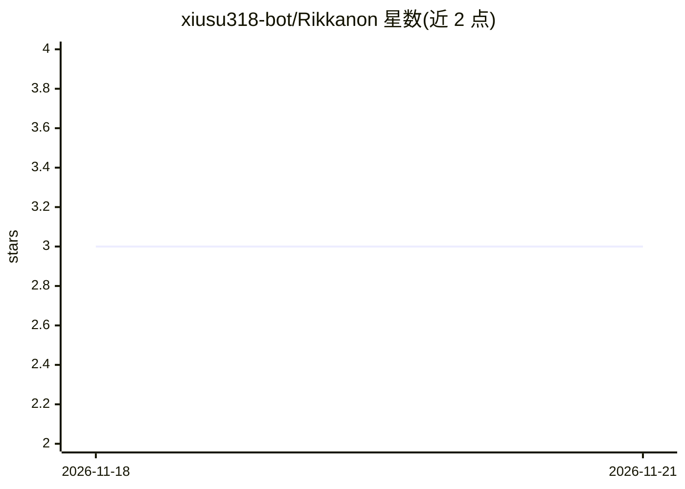

# xiusu318-bot/Rikkanon

⭐ 3 · Kotlin · AGPL-3.0 · 推送 2026-11-09 · [GitHub](https://github.com/xiusu318-bot/Rikkanon) · 个人维护 · 中文 README

**Android AI Agent 客户端（RikkaHub 二开），带子代理与终端**

基于 RikkaHub 二次开发的个人向 Android AI Agent 客户端。保留 2.5.6 经典紧凑 UI，新增多模型子代理（独立模块、并发池、5 级控制权限）、持久化交互式 PTY 多终端与 PRoot 本地沙盒、QuickJS JS 插件系统（无沙盒限制，需自行审源码）、酒馆式提示词预设/世界书/深度注入、双层 Roll 与消息 JSON 编辑器、多代理节点独立出站。通过 GitHub Releases 下载 APK 安装，支持与原版共存；未经过大规模测试，作者声明可能存在未知 Bug。

## 筛选速览

| 维度 | 判定 | 备注 |
|---|---|---|
| AI 角色 | `ai-native` | 本体是模型或模型工具 |
| 许可风险 | `viral` | AGPL-3.0 |
| 部署形态 | `None` |  |
| 模型依赖 | — | README 未给出锁定关系 |
| 硬件要求 | — | 无带数字的原话,不猜 |
| 安装摩擦 | `low` | 无编译、无系统依赖或容器化 |
| 成熟度 | `idea` | |

## 能力要点

- 多模型子代理模块：并发池、单轮步数限制、5 级主代理控制权限与双轨审批
- 持久化交互式 PTY 多终端与本地 PRoot 沙盒（含 6 项兼容补丁）
- QuickJS 插件系统：注册工具、拦截改写 HTTP/SSE 与提示词结构，无能力限制
- 酒馆式高级提示词模式：世界书引擎、@D 深度注入、支持导入酒馆预设 JSON

## 适用场景

- 在 Android 手机上运行带本地沙盒终端的 AI Agent 对话
- 为主代理配置多个不同模型的子代理并控制其权限与审批
- 使用酒馆预设与世界书管理长对话提示词

## 场景标签

`AI 助手` `提示工程` · 领域:Agent 开发

## 证据(README 行号)

> L3:  基于 RikkaHub 二次开发的个人向 Android AI Agent 客户端
> L76: - **持久化交互式伪终端工具 (`workspace_terminal`)**：结合终端会话池扩展出供 AI 持续交互的伪终端工具（同时支持本地 PRoot 与远程 SSH 工作区）。终端按工作区共享，主对话、子代理、新开对话与
> L86:  - 支持通过复选框绑定 **1 个或多个助手**作为子代理（每个子代理拥有独立的模型、系统提示词、思考强度、MCP 与 Skills），支持在页面内快速新建子代理助手。

## 星数曲线

2026-11-18 3 → 2026-11-21 3（+0）

---
*卡片 v1 · prompt 1.4 · 生成 2026-11-21 · 置信度 high · 依据 README sha `29c7a89bfb7b` · [字段定义](../../DATASET.md)*
