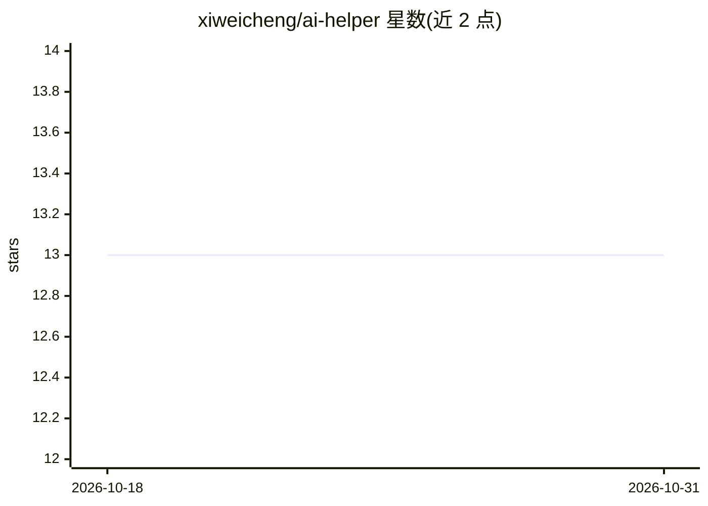

# xiweicheng/ai-helper

⭐ 13 · JavaScript · MIT · 推送 2026-10-30 · [GitHub](https://github.com/xiweicheng/ai-helper) · [官网](https://xiweicheng.github.io/ai-helper/) · 个人维护 · 中文 README

**让 LLM 直接操作网页的开源浏览器插件：点击、填表、跑命令**

面向普通用户的 Chrome/Edge 浏览器扩展（MIT）：以 ReAct 推理循环驱动 40+ 内置工具，代用户点击、填写表单、上传文件、运行终端命令、总结页面并导出、定时监控页面；支持多智能体协作与 MCP 协议扩展。可选本地 Agent 服务解锁本地文件读写、终端命令、本地 RAG 知识库与本地 ONNX 语音识别（音频不出本机）。接入任意 OpenAI 兼容端点，DeepSeek 预设内置；要求 Chrome/Edge/Chromium 114+（Side Panel API）。

## 筛选速览

| 维度 | 判定 | 备注 |
|---|---|---|
| AI 角色 | `ai-native` | 本体是模型或模型工具 |
| 许可风险 | `permissive` | MIT |
| 部署形态 | `desktop` | 安装包/桌面程序 |
| 模型依赖 | — | README 未给出锁定关系 |
| 硬件要求 | — | 无带数字的原话,不猜 |
| 安装摩擦 | `low` | 无编译、无系统依赖或容器化 |
| 成熟度 | — | 结构信号不足 |

## 能力要点

- ReAct 循环 + 40+ 内置工具操作网页（含 Shadow DOM 与 React 受控组件）
- 可选 Agent 服务：本地文件读写、终端命令（三级命令安全 + 7 天回收站）
- 本地知识库（RAG）混合检索并给出可点击引用
- 本地 ONNX 语音识别输入，音频不出本机

## 适用场景

- 一句话让 AI 批量填写复杂表单并上传附件
- 定时监控指定页面并把结果写入会话
- 对本机文档建知识库做带引用的问答
- 语音输入代替打字与 AI 对话

## 场景标签

`浏览器自动化` `AI 助手` `多智能体` `文档问答` · 领域:Agent 开发

## 证据(README 行号)

> L5: ### The open-source browser extension that lets LLMs actually operate web pages
> L7: Not just chat — it clicks, fills forms, drags, uploads files, runs terminal commands, and extends via MCP.
> L21: **AI Helper product introduction** (~4 min · narrated): complete walkthrough of the ReAct reasoning loop, 40+ built

## 星数曲线

2026-10-18 13 → 2026-10-31 13（+0）

---
*卡片 v1 · prompt 1.4 · 生成 2026-10-31 · 置信度 high · 依据 README sha `c6cb5581ca1a` · [字段定义](../../DATASET.md)*
