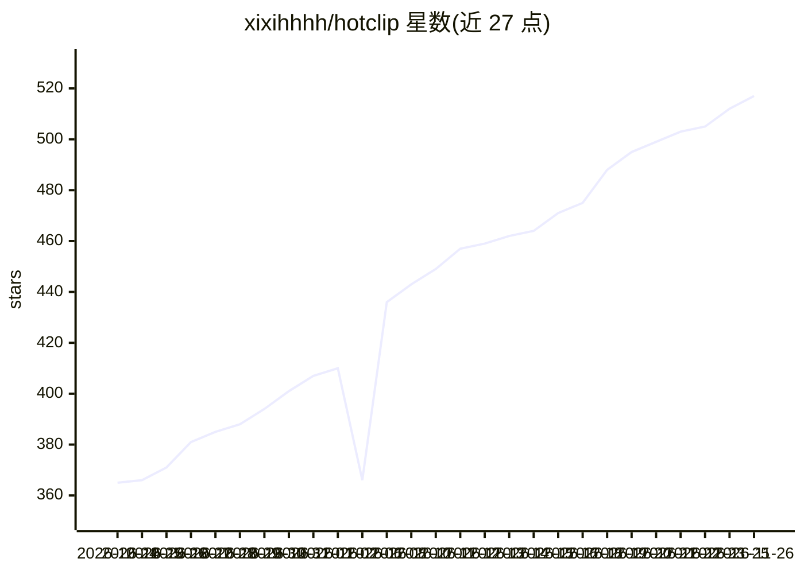

# xixihhhh/hotclip

⭐ 517 · TypeScript · AGPL-3.0 · 推送 2026-11-20 · [GitHub](https://github.com/xixihhhh/hotclip) · [官网](https://xixihhhh.github.io/hotclip/) · 个人维护 · 中文 README

**本地运行的 AI 切片工具：长视频与直播回放一键切竖屏短视频**

Electron 桌面应用，将长视频、直播回放、播客导入后经本地逐字转写（SenseVoice/Paraformer/FireRedASR2 三档本地引擎）与 LLM 爆点分析，生成带爆款分、推荐理由与逐字对齐切点的候选片段，导出 9:16 竖屏成片并自动加动态字幕、封面与发布文案。弹幕文件、响度、镜头与表情峰值作为爆点判断信号；另提供 CLI、MCP server 与录播监听自动出片。全程本地处理、不上传素材，AGPL-3.0 开源，Windows/macOS/Linux 提供安装包。

## 筛选速览

| 维度 | 判定 | 备注 |
|---|---|---|
| AI 角色 | `ai-native` | 本体是模型或模型工具 |
| 许可风险 | `viral` | AGPL-3.0 |
| 部署形态 | `desktop` | 安装包/桌面程序 |
| 模型依赖 | local-ok | 支持本地模型 |
| 硬件要求 | — | 无带数字的原话,不猜 |
| 安装摩擦 | `medium` | 含编译或系统依赖之一 |
| 成熟度 | — | 结构信号不足 |

## 能力要点

- 本地转写三档引擎（SenseVoice/Paraformer/FireRedASR2），普通 CPU 可运行
- 弹幕热度（B站录播姬 .xml / 抖音 .jsonl）进爆点判断
- 横屏转竖屏智能取景 + 词级时间戳动态字幕
- 提供 CLI、MCP server 与 7×24 录播监听自动切片

## 适用场景

- 下播后把几小时直播回放自动切成高光短视频
- 播客纯音频转成竖屏视频发布
- 带货直播按商品讲解模式批量切片并生成发布文案
- 通过 MCP 让 Agent 一句话完成切片交付

## 场景标签

`语音识别` `图像视频处理` · 领域:感知与多模态

## 证据(README 行号)

> L73: 2. **AI 找爆点**:本地逐字转写 → AI 通读全文挑出金句、冲突、高能片段,每条附**爆款分、开场钩子和推荐理由**,切点精确到词;看不顺眼的取消勾选即可
> L138: 快速 SenseVoice(五语种,170MB)/ 均衡 Paraformer(中文更准)/ 最准 FireRedASR2(普通话/方言/中英混说)——全部本地运行、普通 CPU 就能跑,首次自动下载(国内镜像优先、断点续传);
> L160: - **视觉爆点信号(可选)**:新用户默认预填本机 Ollama `qwen3.5:4b`,一个多模态模型同时处理文字与九宫格接触表,研判画面高能时刻,专治逐字稿里看不见的画面梗;端点不可用自动跳过,不会挡住纯文字找爆点

## 星数曲线

2026-10-24 365 → 2026-11-26 517（+152）

---
*卡片 v1 · prompt 1.4 · 生成 2026-11-25 · 置信度 mid · 依据 README sha `1ea3a0499117` · [字段定义](../../DATASET.md)*
