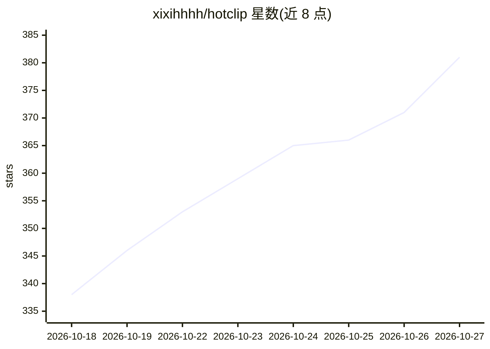

# xixihhhh/hotclip

⭐ 381 · TypeScript · AGPL-3.0 · 推送 2026-10-26 · [GitHub](https://github.com/xixihhhh/hotclip) · [官网](https://xixihhhh.github.io/hotclip/) · 个人维护 · 中文 README

**本地运行的 AI 长视频/直播回放切片工具，一键生成竖屏短视频**

面向主播、切片手、带货团队、播客主的桌面端（Electron）视频剪辑工具：导入长视频或直播回放，本地逐字转写（SenseVoice/Paraformer/FireRedASR 三档）后由 LLM 挑选高光片段，切点由转写反向对齐，附爆款分与推荐理由；结合弹幕热度、响度、表情等多路信号，自动生成 9:16 竖屏成片、动态字幕、封面与发布文案。全程本地处理、无水印不上传，Windows/macOS 提供安装包，Linux 为实验性 AppImage；提供 CLI 与 MCP 工具，可选本机 Ollama 视觉模型参与画面研判。

## 筛选速览

| 维度 | 判定 | 备注 |
|---|---|---|
| AI 角色 | `ai-native` | 本体是模型或模型工具 |
| 许可风险 | `viral` | AGPL-3.0 |
| 部署形态 | `desktop` | 安装包/桌面程序 |
| 模型依赖 | local-ok | 支持本地模型 |
| 硬件要求 | — | 无带数字的原话,不猜 |
| 安装摩擦 | `medium` | 含编译或系统依赖之一 |
| 成熟度 | — | 结构信号不足 |

## 能力要点

- 本地三档转写引擎 + LLM 找爆点，切点逐字对齐并附爆款分/推荐理由
- 弹幕（B站录播姬/抖音）互动热度进入爆点判断
- 9:16 竖屏重构、逐字动态字幕、发布文案与平台发布包一次出齐
- AGPL-3.0 开源、全程本地运行、无需注册，提供 CLI/MCP 与录播 7×24 监听自动出片

## 适用场景

- 下播后把几小时直播回放自动切成高光短视频
- 播客纯音频自动合成波形动画竖屏视频
- 带货直播按转化逻辑批量出切片并整理各平台发布包

## 场景标签

`图像视频处理` `AI 写作` · 领域:内容生成

## 证据(README 行号)

> L58: 2. **AI 找爆点**:本地逐字转写 → AI 通读全文挑出金句、冲突、高能片段,每条附**爆款分、开场钩子和推荐理由**,切点精确到词;看不顺眼的取消勾选即可
> L123: 快速 SenseVoice(五语种,170MB)/ 均衡 Paraformer(中文更准)/ 最准 FireRedASR2(普通话/方言/中英混说)——全部本地运行、普通 CPU 就能跑,首次自动下载(国内镜像优先、断点续传);

## 星数曲线

2026-10-18 338 → 2026-10-27 381（+43）

---
*卡片 v1 · prompt 1.4 · 生成 2026-10-21 · 置信度 mid · 依据 README sha `04db75303484` · [字段定义](../../DATASET.md)*
