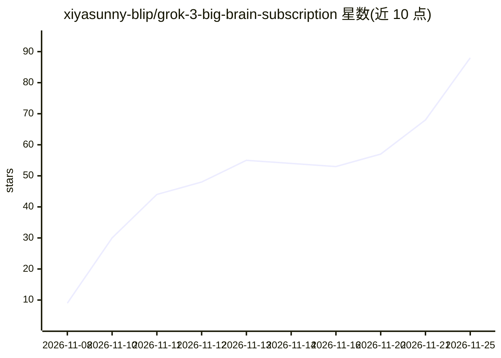

# xiyasunny-blip/grok-3-big-brain-subscription

⭐ 88 · 推送 2026-11-06 · [GitHub](https://github.com/xiyasunny-blip/grok-3-big-brain-subscription) · [官网](https://app.coregold.io/signup?invite_code=ADvlj9b) · 组织维护 · 中文 README

**推销 CoreGold 虚拟卡以订阅 Grok 3 的推广文**

以 Grok 3 / Big Brain 模式订阅为题的支付推广内容：先描述 X 平台跨国支付风控与多账号连坐封禁的机制，再以对照表形式将个人双币卡/代充与 CoreGold 商业卡段对比，最后给出注资 USDT、开立商业卡段、绑定北美 AVS 地址完成扣款的三步操作指南，并以链接与口令结尾引导进入 CoreGold 开卡控制台。仓库不含可安装的代码或工具，实为虚拟卡服务的导流页面。

## 筛选速览

| 维度 | 判定 | 备注 |
|---|---|---|
| AI 角色 | `ai-enhanced` | 去掉 AI 部分产品仍成立 |
| 许可风险 | `none` | — |
| 部署形态 | `None` |  |
| 模型依赖 | — | README 未给出锁定关系 |
| 硬件要求 | — | 无带数字的原话,不猜 |
| 安装摩擦 | `low` | 无编译、无系统依赖或容器化 |
| 成熟度 | — | 结构信号不足 |

## 能力要点

- 内容主体为 CoreGold 商业卡段的推广与三步开卡支付指南
- 描述了 X 平台跨国支付风控与多账号同卡连坐封禁机制
- 以对照表形式比较双币卡/代充与商业卡段的通过率、账号隔离与额度管理
- 末尾提供开卡控制台链接与口令

## 适用场景

- 寻找可绕过跨国支付风控完成 X Premium 订阅的虚拟卡渠道
- 为多账号矩阵寻求一号一卡的支付隔离方案

## 场景标签

 · 领域:支付服务/营销内容

## 证据(README 行号)

> L24: + CoreGold 商业卡段:
> L31: 1. **注资**：登录 CoreGold 控制台，充入 25~45 USDT，秒转 USD 资金。
> L35: 👉 **立即进入 CoreGold 开卡控制台**

## 星数曲线

2026-11-08 9 → 2026-11-25 88（+79）

---
*卡片 v1 · prompt 1.4 · 生成 2026-11-18 · 置信度 high · 依据 README sha `673dc87720a5` · [字段定义](../../DATASET.md)*
