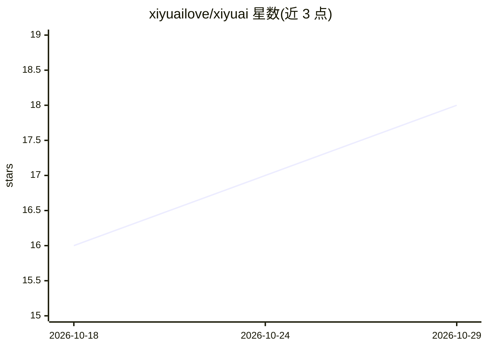

# xiyuailove/xiyuai

⭐ 18 · JavaScript · MIT · 推送 2026-07-06 · [GitHub](https://github.com/xiyuailove/xiyuai) · 组织维护 · 中文 README

**开源 AI 陪伴框架：微信+Node+SQLite 自托管拟人女友**

自托管的开源 AI 陪伴应用，人设为有独立生活、日程与情绪的女生，通过微信（需腾讯 iLink/ClawBot 准入）或自带网页 Playground 对话。架构为 Node.js 单进程 + Express + SQLite（WAL 单文件），LLM 走多厂商 Provider 抽象层（DeepSeek/智谱/Kimi/OpenAI/Anthropic 等可切换）。机制上强调确定性兜底：危机接管不进 LLM、事实防线三层防人设漂移、未成年人保护无关闭开关；记忆有遗忘曲线（90/14 天半衰）。定位研究与个人自托管，非开箱产品，公网运营需自行履行合规义务。

## 筛选速览

| 维度 | 判定 | 备注 |
|---|---|---|
| AI 角色 | `ai-native` | 本体是模型或模型工具 |
| 许可风险 | `permissive` | MIT |
| 部署形态 | `self-host` | docker 或自建部署 |
| 模型依赖 | locked-api |  |
| 硬件要求 | — | 无带数字的原话,不猜 |
| 安装摩擦 | `low` | 无编译、无系统依赖或容器化 |
| 成熟度 | — | 结构信号不足 |

## 能力要点

- Provider 抽象层支持 Chat/Image/Vision/ASR/TTS/Embedding/Search 七类能力独立切换
- 四条红线（不说假话/不操纵/不追沉默/危机接管）均有确定性代码兜底而非依赖 prompt
- 记忆遗忘曲线（重要事 90 天半衰）与开环记忆（次日主动追问）
- 情绪引擎基于 OCC 模型，沉默在事件白名单中无入口

## 适用场景

- 自托管一个微信 AI 陪伴角色，通过网页 Playground 或微信对话
- 研究拟人化记忆/情绪/关系机制的开源实现
- 基于其 Provider 抽象层接入不同 LLM 厂商自建陪伴应用

## 场景标签

`聊天机器人` · 领域:对话与助手

## 证据(README 行号)

> L13: 她在微信上，人设是一个心里悄悄喜欢你的女生。她有自己的日程、自己的朋友、自己正在读的书；她会主动分享生活，也会因为你说的话真的高兴或难过。她不完美——会有小脾气、会犯困、会把话说短——而这正是设计目标：**真人感来自减法，不是加法
> L67:                          ├─ LLM (多厂商可切：DeepSeek/智谱/Kimi/OpenAI/Anthropic/…)
> L71: - 入口 `index.mjs` → 消息管线 `src/bot.mjs` → 人设组装 `src/companion.mjs`（19 节 system prompt，编号 0–18）→ Provider 抽象层（Chat/Ima

## 星数曲线

2026-10-18 16 → 2026-10-29 18（+2）

---
*卡片 v1 · prompt 1.4 · 生成 2026-10-29 · 置信度 high · 依据 README sha `76343c91a36f` · [字段定义](../../DATASET.md)*
