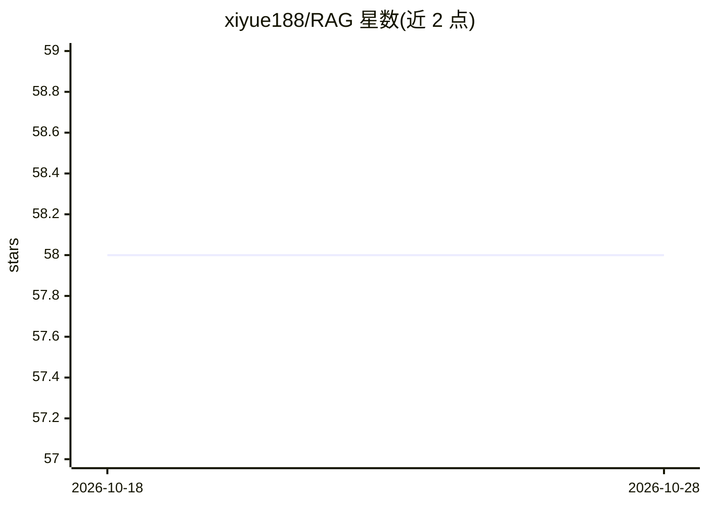

# xiyue188/RAG

⭐ 58 · Python · MIT · 推送 2026-10-13 · [GitHub](https://github.com/xiyue188/RAG) · [官网](http://deepblue-brain.cn/) · 个人维护 · 中文 README

**面向开发者与研究者的 RAG 全链路白盒化观察平台**

DeepBlue Brain 是一个可追溯的 RAG 知识库研究平台，用户为开发者与研究者，目标是让 RAG 系统本身可被观察与验证。支持 .md/.txt/.pdf/.docx 上传，SSE 流式问答与上传进度，实时检索日志流展示走向量/BM25/混合模式及各路分数，Prompt Inspector 可查看实际送入模型的完整提示词，点击引用可查看原文证据卡片。技术选型用 T2Ranking 数据集实测验证并公开负面结果。技术栈为 Vue3 + FastAPI + ChromaDB + sentence-transformers，支持 OpenAI/Anthropic/智谱/通义千问四种 LLM，提供 Docker Compose 部署。限制：PDF 扫描件无法抽取内容需 OCR，docx 表格与图片文字丢失，单文件上限 10 MB。

## 筛选速览

| 维度 | 判定 | 备注 |
|---|---|---|
| AI 角色 | `ai-native` | 本体是模型或模型工具 |
| 许可风险 | `permissive` | MIT |
| 部署形态 | `self-host` | docker 或自建部署 |
| 模型依赖 | — | README 未给出锁定关系 |
| 硬件要求 | — | 无带数字的原话,不猜 |
| 安装摩擦 | `low` | 无编译、无系统依赖或容器化 |
| 成熟度 | — | 结构信号不足 |

## 能力要点

- 实时检索日志流（SSE）展示检索路径、命中文档与分数
- Prompt Inspector 展示实际送入模型的完整 Prompt
- 引用可点击查看原文片段、chunk ID 与相关性分数
- 技术选型经 T2Ranking 公开数据集实测验证，含负面结果

## 适用场景

- 排查 RAG 项目问题出在分块、embedding、检索还是 prompt 哪一环
- 对比检索方案并用自有数据集复现评测
- 作品集中展示 RAG 可解释性与工程严谨度

## 场景标签

`RAG` `模型评测` · 领域:评测与运维

## 证据(README 行号)

> L3: **可追溯的 RAG 知识库研究平台** —— 全链路白盒化，且每个技术决策都有评测数据支撑。
> L24: 本项目的目标是**让 RAG 系统本身可被观察和验证**，用户是开发者与研究者。

## 星数曲线

2026-10-18 58 → 2026-10-28 58（+0）

---
*卡片 v1 · prompt 1.4 · 生成 2026-10-24 · 置信度 mid · 依据 README sha `b44989a8cccb` · [字段定义](../../DATASET.md)*
