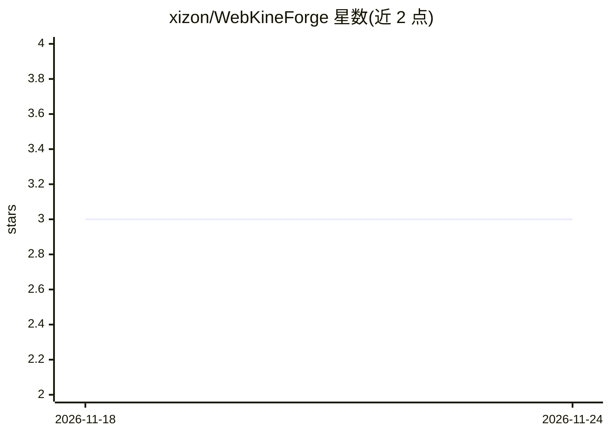

# xizon/WebKineForge

⭐ — · [GitHub]() · 个人维护 · 中文 README

**给开发者的静态网站构建工具包，内置 AI Agent 协作**

面向前端开发者的网站创建工具包：以 HTML/TypeScript/Tailwind 编写组件，构建输出无运行时框架的独立静态页面，可部署或接入 PHP、Java、WordPress、Next.js 等栈。采用多 Site 沙箱结构，各 Site 独立构建与部署。构建时生成 component-index.json 与 page-index.json 供 AI Agent 使用，支持配合 Cursor、Codex、Claude Code 开发组件与页面。需 Node.js 22.12.0+，通过 npm 安装运行，npx 可下载已发布 Site 的网站模板。不覆盖后端、认证与数据库。

## 筛选速览

| 维度 | 判定 | 备注 |
|---|---|---|
| AI 角色 | `ai-enhanced` | 去掉 AI 部分产品仍成立 |
| 许可风险 | `permissive` | — |
| 部署形态 | `library` | 以包/库形式分发 |
| 模型依赖 | — | README 未给出锁定关系 |
| 硬件要求 | — | 无带数字的原话,不猜 |
| 安装摩擦 | `low` | 无编译、无系统依赖或容器化 |
| 成熟度 | — | 结构信号不足 |

## 能力要点

- 构建输出无运行时框架的独立静态 HTML 页面与资源
- 内置 AI Agent，配合 Cursor、Codex、Claude Code 开发组件与页面
- 多 Site 沙箱结构，支持跨 Site 共享组件与静态资源
- npx 一条命令下载已发布 WebKineForge Site 的 HTML 网站模板

## 适用场景

- 构建交互动画网站并部署到 CDN 或 Nginx 等静态托管
- 把静态页面输出接入现有的 Next.js、WordPress、PHP 项目
- 用 CLI 快速创建 Site、组件与页面并实时预览
- 与 AI 编码工具协作开发前端组件

## 场景标签

 · 领域:前端开发工具

## 证据(README 行号)

> L11: **A web creation toolkit for developers. Build interactive websites with clean, maintainable HTML and built-in AI A
> L67: - **AI-assisted development**: Built-in AI agent for developing components and pages with Cursor, Codex, and Claude
> L103: > The build generates `tsconfig.json`, `component-index.json` and `page-index.json` for each Site. Therefore, you 

## 星数曲线

2026-11-18 3 → 2026-11-24 3（+0）

---
*卡片 v1 · prompt 1.4 · 生成 2026-11-21 · 置信度 high · 依据 README sha `d8fcdaeb6f49` · [字段定义](../../DATASET.md)*
