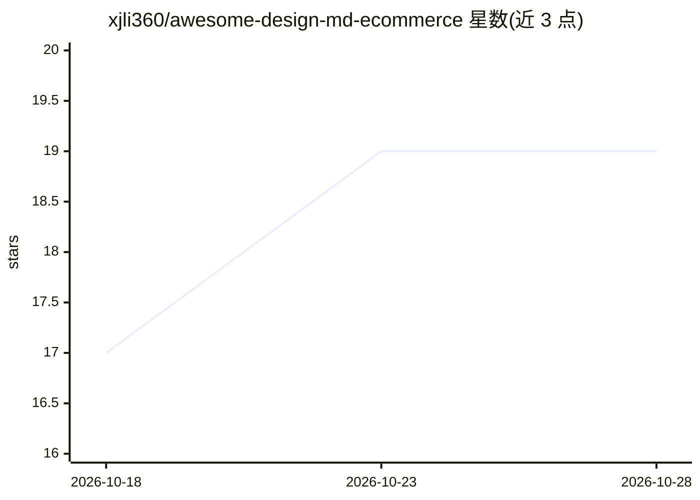

# xjli360/awesome-design-md-ecommerce

⭐ 19 · Python · MIT · 推送 2026-09-30 · [GitHub](https://github.com/xjli360/awesome-design-md-ecommerce) · 组织维护 · 中文 README

**电商品牌 DESIGN.md 设计规范合集，供 AI 编码 agent 构建品牌一致 UI**

面向 AI 编码 agent（Claude Code、Cursor、Copilot、v0 等）的电商设计参考数据集：从 2,636 个独立网站抓取公开 CSS 证据，用自动化管线生成 2,733 个 DESIGN.md 文件，按固定九节结构记录配色、字体、圆角、间距与组件模式，并附 MEASUREMENTS.json 与截图证据。每份文件标注证据局限与 Known Gaps，历史归档默认不进推荐。使用方式是把参考文件放入 agent 上下文让其按规范构建 UI；仓库另含可复现的爬取、验证、发布脚本管线。

## 筛选速览

| 维度 | 判定 | 备注 |
|---|---|---|
| AI 角色 | `ai-knowledge` | 知识聚合/清单类 |
| 许可风险 | `permissive` | MIT |
| 部署形态 | `None` |  |
| 模型依赖 | — | README 未给出锁定关系 |
| 硬件要求 | — | 无带数字的原话,不猜 |
| 安装摩擦 | `low` | 无编译、无系统依赖或容器化 |
| 成熟度 | — | 结构信号不足 |

## 能力要点

- 2,636 个独立网站 · 2,733 个 DESIGN.md 文件 · 306 个分类
- 每份文件固定九节结构：colors/typography/rounded/spacing/components 等
- 每条记录保留来源 URL、抓取时间、内容哈希等证据链
- 自动化管线脚本支持断点续跑与像素级原型对比

## 适用场景

- 让 AI 编码 agent 按某品牌的字体与配色构建商品页原型
- 设计工程师快速查找真实电商网站的设计令牌参考
- 为 Agency 提案制作品牌风格一致的界面 mockup

## 场景标签

`精选清单` · 领域:学习与行业

## 证据(README 行号)

> L9: **An evidence-qualified collection of e-commerce design references** for AI coding agents. Files describe observed C
> L90: **2,636 unique website URLs · 2,733 DESIGN.md files · 306 categories.**
> L40: **Who it's for** — design engineers prototyping on-brand UI · agencies pitching brand-faithful mockups · indie hack

## 星数曲线

2026-10-18 17 → 2026-10-28 19（+2）

---
*卡片 v1 · prompt 1.4 · 生成 2026-10-28 · 置信度 high · 依据 README sha `3405e6ff1b9f` · [字段定义](../../DATASET.md)*
