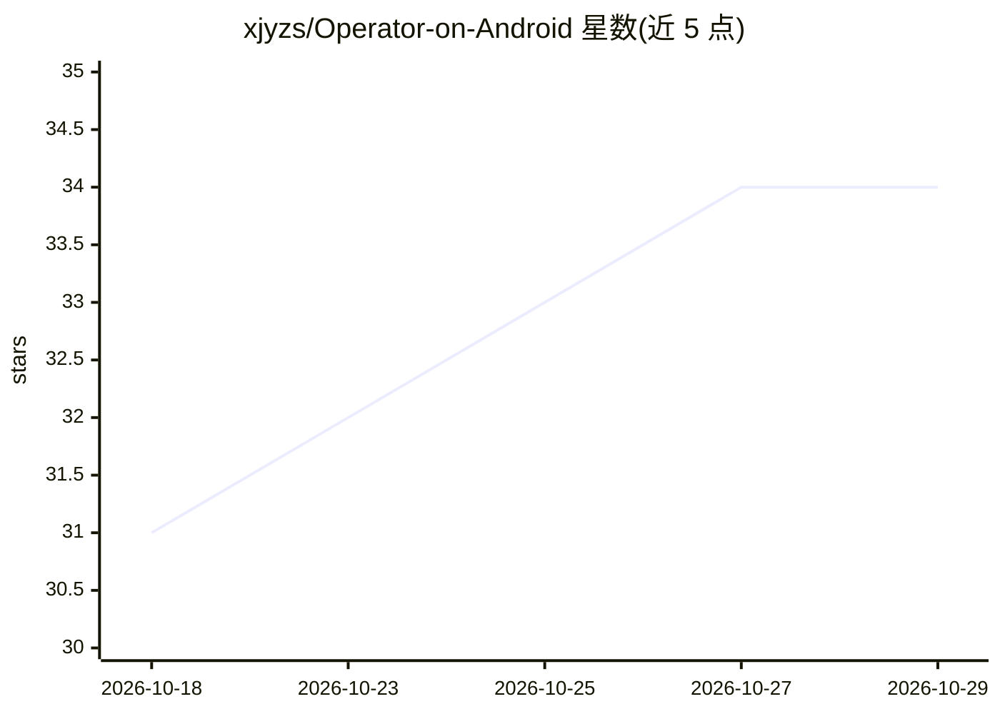

# xjyzs/Operator-on-Android

⭐ 34 · Kotlin · MIT · 推送 2026-10-06 · [GitHub](https://github.com/xjyzs/Operator-on-Android) · [官网](http://self.655300.xyz/Operator-on-Android/) · 个人维护 · 中文 README

**安卓端侧 AI Agent：用视觉语言模型直接操作手机**

运行在 Android 设备上的 UI 自动化 Agent 应用：用户在手机上配置 LLM/VLM 服务的 URL、API Key 与模型名后，通过自然语言指令让 AI 在虚拟屏上后台操作任意已安装应用，不占用主屏，可聊天或看视频的同时执行任务。基于无障碍服务解析界面布局并向模型提供元素坐标等上下文；内置 token 消耗统计、可视化点击标记与状态栏任务状态（Android 16+）。以 APK 形式分发，按 Android 版本与架构提供多个安装包；不同 ROM 的虚拟屏与息屏触控注入存在已知限制。

## 筛选速览

| 维度 | 判定 | 备注 |
|---|---|---|
| AI 角色 | `ai-native` | 本体是模型或模型工具 |
| 许可风险 | `permissive` | MIT |
| 部署形态 | `None` |  |
| 模型依赖 | — | README 未给出锁定关系 |
| 硬件要求 | — | 无带数字的原话,不猜 |
| 安装摩擦 | `low` | 无编译、无系统依赖或容器化 |
| 成熟度 | — | 结构信号不足 |

## 能力要点

- 虚拟屏后台执行，不占用主屏幕
- 基于 Android 无障碍服务的界面布局解析与元素坐标
- 内置 token 消耗与 API 费用统计
- 按设备架构提供多版本 APK（Android 8.0+/10+/15+/x86_64 模拟器/通用包）

## 适用场景

- 在手机上用自然语言指令让 AI 代为操作应用，无需连接电脑
- 后台自动执行任务的同时继续使用手机其他功能
- 通过状态栏跟踪 AI 任务的执行进度

## 场景标签

`GUI 自动化` · 领域:效率与自动化

## 证据(README 行号)

> L1: # Operator - On-Device AI Agent for Android UI Automation
> L6: ## Call AI APIs directly from your phone. No PC connection required—let the AI operate your device untethered!
> L32: Follow the in-app prompts to configure your API settings. Fill in the `URL`, `API Key`, and the `Model Name` provid

## 星数曲线

2026-10-18 31 → 2026-10-29 34（+3）

---
*卡片 v1 · prompt 1.4 · 生成 2026-10-25 · 置信度 high · 依据 README sha `fc6bd4d1d57b` · [字段定义](../../DATASET.md)*
