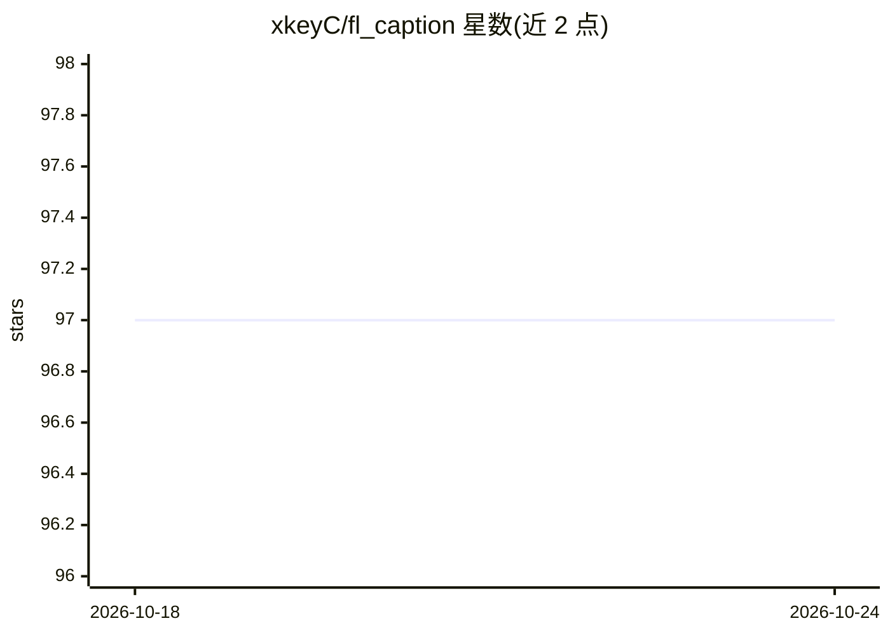

# xkeyC/fl_caption

⭐ 97 · Dart · AGPL-3.0 · 推送 2026-10-18 · [GitHub](https://github.com/xkeyC/fl_caption) · 个人维护 · 中文 README

**离线实时字幕与翻译工具，识别电脑声音并实时翻译**

用 Flutter 与 Rust 编写的桌面应用：捕获系统声音或麦克风，边说边出字幕（约 0.4 秒刷新、停顿后定稿），并用本地翻译模型实时翻译，翻译也可改用 OpenAI 兼容接口（DeepSeek、Ollama、LM Studio 等）。推理基于 local-multimodal-infra，模型经 ONNX Runtime 在本机运行。另支持音视频文件转 SRT/VTT/LRC/TXT 字幕或歌词、热词与术语表、双语输出。面向 Windows 10/11 与 Linux x64 用户，NVIDIA GPU 加速需约 3.5 GB 显存起，无显卡可用 CPU 版识别加在线 API 翻译。

## 筛选速览

| 维度 | 判定 | 备注 |
|---|---|---|
| AI 角色 | `ai-native` | 本体是模型或模型工具 |
| 许可风险 | `viral` | AGPL-3.0 |
| 部署形态 | `desktop` | 安装包/桌面程序 |
| 模型依赖 | local-ok | 支持本地模型 |
| 硬件要求 | `gpu-8g` | |
| 安装摩擦 | `medium` | 含编译或系统依赖之一 |
| 成熟度 | — | 结构信号不足 |

## 能力要点

- 本地 ONNX Runtime 运行识别与翻译模型，全程离线可用
- 实时字幕每约 0.4 秒刷新、翻译复用 KV 前缀缓存
- 文件转字幕/歌词支持 SRT/VTT/LRC/TXT 与双语输出
- 应用内模型下载（含 Hugging Face 镜像）与显存占用估算

## 适用场景

- 看外语视频或开英文会议时实时出双语字幕
- 把录音、视频文件批量转成字幕或歌词文件
- 无网络环境下用本机模型做语音识别和翻译

## 场景标签

`语音识别` · 领域:感知与多模态

## 证据(README 行号)

> L5: 离线的实时字幕与翻译工具：识别电脑正在播放的声音或麦克风，边说边出字幕，并实时翻译成你的语言；也能把音视频文件转成字幕或歌词文件。多模态推理基于 local-multimodal-infra 实现，所有模型都在本机通过 ONNX R
> L11: - **边说边出的字幕**：说话期间每约 0.4 秒刷新一次正在说的句子，文字只在末尾增长、左对齐、位置固定；停顿后约 0.45 秒给出定稿。GPU 上每次识别 10–30 ms。
> L12: - **实时翻译**：本地翻译模型复用上一句的 KV 缓存，只计算新增的部分，一句约 0.1 秒；正在说的句子也会边说边翻。可改用 DeepSeek、OpenAI、Ollama、LM Studio 等 OpenAI 兼容接口。

## 星数曲线

2026-10-18 97 → 2026-10-24 97（+0）

---
*卡片 v1 · prompt 1.4 · 生成 2026-10-23 · 置信度 high · 依据 README sha `624775dac484` · [字段定义](../../DATASET.md)*
