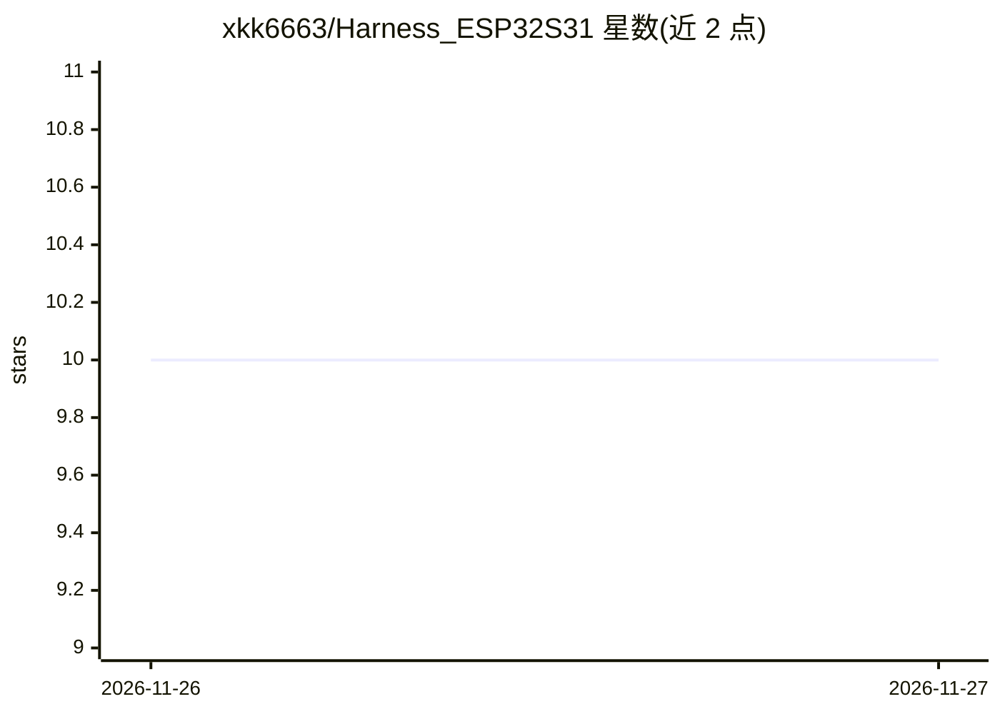

# xkk6663/Harness_ESP32S31

⭐ 10 · C · 推送 2026-11-12 · [GitHub](https://github.com/xkk6663/Harness_ESP32S31) · [官网](https://xkk6663.github.io/Harness_ESP32S31/) · 个人维护 · 中文 README

**ESP32-S31 开发板的多功能智能音箱固件（蓝牙音箱/副屏/对讲/OTA）**

面向 ESP32-S31-Korvo-1 开发板的 ESP-IDF 固件工程：设备提供 7 个 Tab 功能，包括 A2DP 蓝牙音箱、SD 卡音视频播放、局域网 UDP 全双工对讲、本地录音、PC 音乐副屏推流（网易云播放态/歌词/封面）、天气时钟，以及 A/B 双槽 WiFi OTA 升级与 USB 扩展屏双固件切换。仓库还沉淀了一套 Agent 可读的工程规范与闭环 SOP（读规范→写代码→烧录→抓日志→验证），PC 端提供 PySide6 上位机。小智 AI 对话接入尚在规划未开工。

## 筛选速览

| 维度 | 判定 | 备注 |
|---|---|---|
| AI 角色 | `ai-enhanced` | 去掉 AI 部分产品仍成立 |
| 许可风险 | `none` | — |
| 部署形态 | `desktop` | 安装包/桌面程序 |
| 模型依赖 | — | README 未给出锁定关系 |
| 硬件要求 | — | 无带数字的原话,不猜 |
| 安装摩擦 | `low` | 无编译、无系统依赖或容器化 |
| 成熟度 | — | 结构信号不足 |

## 能力要点

- A/B 双槽 WiFi OTA：段哈希断点续传、bootloader 自动回滚等防砖机制
- A2DP Sink/Source 蓝牙双模式，AVRCP 取歌名与进度
- USB 扩展屏双固件架构（主固件 ⇄ 副屏固件 SET 键一键切换）
- Agent 闭环开发 SOP：skills/esp-idf-closed-loop.md + 工程规范红线清单

## 适用场景

- 把 ESP32-S31 板子做成蓝牙音箱和 PC 歌词副屏
- 需要带防砖 OTA 的双槽固件升级流程的嵌入式项目
- 在局域网内做设备与 PC 的全双工语音对讲
- 让 AI Agent 按 SOP 参与嵌入式固件开发迭代

## 场景标签

 · 领域:嵌入式/智能硬件

## 证据(README 行号)

> L3: **基于 ESP32-S31-Korvo-1 的多功能智能音箱固件：蓝牙音箱 / PC 音乐副屏 / 局域网对讲 / 录音回放 / 音乐视频播放 / WiFi-OTA / USB 扩展屏**
> L40: 一台 ESP32-S31 设备 = **蓝牙音箱 + PC 歌词副屏 + 局域网对讲机 + 录音笔 + 音视频播放器**，主界面 7 个 Tab：
> L274: ## 🧠 如何让 AI Agent 接管开发
> L297: - [ ] 小智 AI 对话接入（方案已定稿：`docs/项目规划/小智AI对话接入实施方案.md`，未开工）

## 星数曲线

2026-11-26 10 → 2026-11-27 10（+0）

---
*卡片 v1 · prompt 1.4 · 生成 2026-11-26 · 置信度 high · 依据 README sha `56efc3ea5b72` · [字段定义](../../DATASET.md)*
