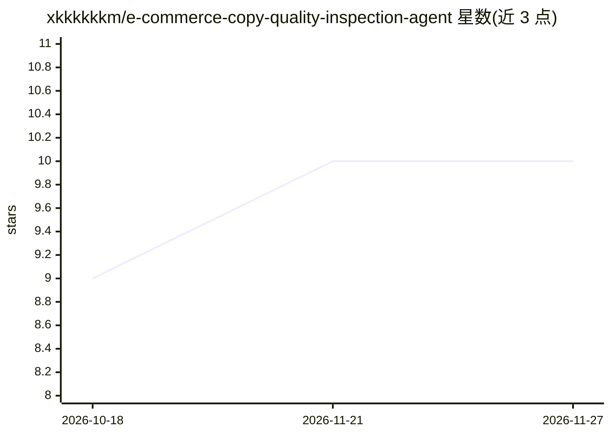

# xkkkkkkm/e-commerce-copy-quality-inspection-agent

⭐ 10 · Python · MIT · 推送 2026-10-06 · [GitHub](https://github.com/xkkkkkkm/e-commerce-copy-quality-inspection-agent) · 个人维护 · 中文 README

**LLM 主导的电商文案质检平台：规则兜底、可审计发布**

一个可运行的工程化平台：商家提交商品文案后由 LLM 先行语义审查，逐条校验引用证据与规则引用，再叠加模型无法覆盖的确定性规则兜底，最终产出可审计的发布决策。采用每租户独立 MySQL schema 的多租户隔离、Redis Streams 任务队列与并发 worker，导出 Prometheus 指标与 Grafana 面板，附带 10,000+ 可复现合成数据生成器。Agent 为自研 Python 编排器，不依赖 LangChain。

## 筛选速览

| 维度 | 判定 | 备注 |
|---|---|---|
| AI 角色 | `ai-native` | 本体是模型或模型工具 |
| 许可风险 | `permissive` | MIT |
| 部署形态 | `self-host` | docker 或自建部署 |
| 模型依赖 | locked-api |  |
| 硬件要求 | — | 无带数字的原话,不猜 |
| 安装摩擦 | `low` | 无编译、无系统依赖或容器化 |
| 成熟度 | — | 结构信号不足 |

## 能力要点

- LLM 审查 + 确定性规则兜底的双层质检管线
- 每租户独立 schema 与数据库账号的多租户隔离
- Redis Streams 队列、fenced lease、重试与恢复机制
- Prometheus/Grafana/Alertmanager 可观测性栈

## 适用场景

- 电商平台批量质检商家提交的商品文案
- 多租户 SaaS 环境下隔离管理审查报告与发布决策
- 生成合成数据做离线基线与负载测试
- 通过仪表盘监控审查任务的并发与告警

## 场景标签

 · 领域:电商/内容审核平台

## 证据(README 行号)

> L5: **LLM-led e-commerce content review with rule-based safeguards and auditable publication decisions.**
> L13: - Manage merchant submissions, immutable revisions, inspection reports and manual publication decisions.
> L14: - Let the LLM inspect original copy against applicable policy first; validate every quoted evidence span and rule r

## 星数曲线

2026-10-18 9 → 2026-11-27 10（+1）

---
*卡片 v1 · prompt 1.4 · 生成 2026-11-21 · 置信度 high · 依据 README sha `d818bd8a2c95` · [字段定义](../../DATASET.md)*
