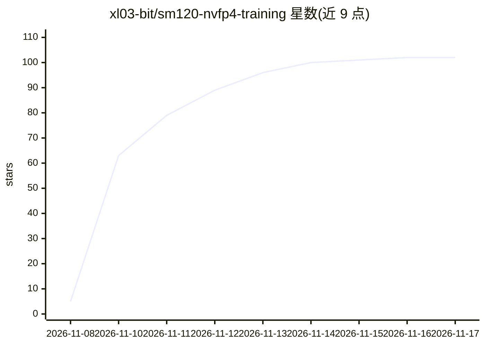

# xl03-bit/sm120-nvfp4-training

⭐ 102 · Python · MIT · 推送 2026-11-13 · [GitHub](https://github.com/xl03-bit/sm120-nvfp4-training) · 个人维护

**SM120 GPU 上的 NVFP4 原生训练库：省显存提速**

基于 PyTorch 的低精度训练包，面向 SM120 架构消费级 GPU（实测 RTX 5060 Ti 16GB），用 FP4 Tensor Core 完成前向/反向计算，配合压缩的权重与 AdamW 状态存储，实现软件随机舍入（SR）与随机 Hadamard 变换（RHT）。提供 6 种全参数训练 profile、冻结权重路径与 LoRA 适配（含保持原精度模式）。限制：单卡实测结果，不保证其他显卡等效；需 CUDA 13.0/nvcc 与 C++ 编译器，首次运行需编译 CUDA 扩展。

## 筛选速览

| 维度 | 判定 | 备注 |
|---|---|---|
| AI 角色 | `ai-ecosystem` | LLM/agent 周边工具 |
| 许可风险 | `permissive` | MIT |
| 部署形态 | `library` | 以包/库形式分发 |
| 模型依赖 | — | README 未给出锁定关系 |
| 硬件要求 | — | 无带数字的原话,不猜 |
| 安装摩擦 | `high` | 编译与系统依赖俱全 |
| 成熟度 | — | 结构信号不足 |

## 能力要点

- FP4 Tensor Core 前向/反向计算，配合 SR 与 RHT
- 6 种全参数训练 profile 控制权重与 AdamW 状态的显存开销
- 冻结权重路径与 LoRA（preserve/nvfp4/packed_nvfp4 三种模式）
- 提供与官方 Transformer Engine 默认配置的实测对比记录

## 适用场景

- 在 16GB 消费级显卡上做 FLUX 等图像模型的 LoRA 训练
- 在有限显存内完成数十亿参数语言模型的全参数训练
- 对比压缩存储策略与官方 FP4 训练实现的吞吐与显存

## 场景标签

`微调` · 领域:训练与推理

## 证据(README 行号)

> L3: **Use native NVFP4 to accelerate training and reduce GPU memory use on SM120 GPUs.** This PyTorch package combines F
> L5: Built on Infatoshi/nvfp4-sm120, it implements software stochastic rounding (SR) and random Hadamard transforms (RHT)

## 星数曲线

2026-11-08 5 → 2026-11-17 102（+97）

---
*卡片 v1 · prompt 1.4 · 生成 2026-11-17 · 置信度 high · 依据 README sha `0787a83c2574` · [字段定义](../../DATASET.md)*
