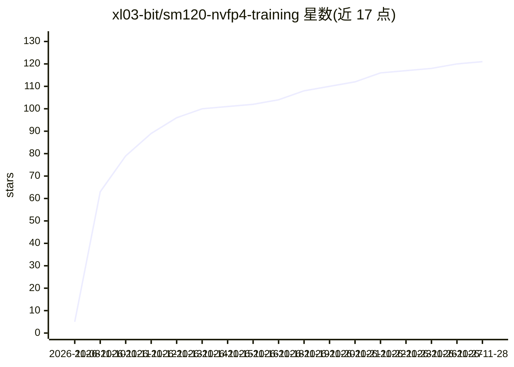

# xl03-bit/sm120-nvfp4-training

⭐ 121 · Python · MIT · 推送 2026-11-26 · [GitHub](https://github.com/xl03-bit/sm120-nvfp4-training) · 个人维护

**SM120 GPU 上的 NVFP4 低精度训练库：加速训练并降低显存占用**

面向 NVIDIA SM120 GPU 的 PyTorch 训练包，将 FP4 Tensor Core 前向/反向计算与紧凑权重及 AdamW 存储结合，提供 6 个全参数训练 profile 与冻结权重、LoRA 路径，实现软件随机舍入与随机 Hadamard 变换。README 给出单张 RTX 5060 Ti 上的完整训练更新测量（吞吐、分配显存、验证损失），并与官方 NVIDIA Transformer Engine 在固定版本下逐项对比，同时标注单卡、单种子测量的局限。

## 筛选速览

| 维度 | 判定 | 备注 |
|---|---|---|
| AI 角色 | `ai-ecosystem` | LLM/agent 周边工具 |
| 许可风险 | `permissive` | MIT |
| 部署形态 | `library` | 以包/库形式分发 |
| 模型依赖 | — | README 未给出锁定关系 |
| 硬件要求 | `gpu-24g` | |
| 安装摩擦 | `high` | 编译与系统依赖俱全 |
| 成熟度 | — | 结构信号不足 |

## 能力要点

- FP4 前向/反向计算 + 紧凑权重/AdamW 存储，6 个训练 profile 可选
- 提供 verify/check 命令编译 CUDA 扩展并做量化、梯度与 checkpoint 校验
- 支持全参数、冻结权重与 LoRA（preserve/nvfp4/packed_nvfp4 模式）训练路径
- 与官方 Transformer Engine 固定版本的吞吐、显存与损失对照表

## 适用场景

- 在 16GB 消费级 GPU 上训练或微调 FLUX.2 等图像模型 LoRA
- 在小显存显卡上跑通数十亿参数语言模型的全参数训练更新
- 按 profile 权衡权重与 AdamW 状态的显存开销
- 对比 NVFP4 与 BF16 训练的吞吐和显存数据

## 场景标签

`微调` `模型量化` · 领域:训练与推理

## 证据(README 行号)

> L3: **Use native NVFP4 to accelerate training and reduce GPU memory use on SM120 GPUs.** This PyTorch package combines F
> L5: Built on Infatoshi/nvfp4-sm120, it implements software stochastic rounding (SR) and random Hadamard transforms (RHT)
> L44: from nvfp4_training import enable_nvfp4, train_step, check_finite

## 星数曲线

2026-11-08 5 → 2026-11-28 121（+116）

---
*卡片 v1 · prompt 1.4 · 生成 2026-11-28 · 置信度 high · 依据 README sha `5d341e573d8f` · [字段定义](../../DATASET.md)*
