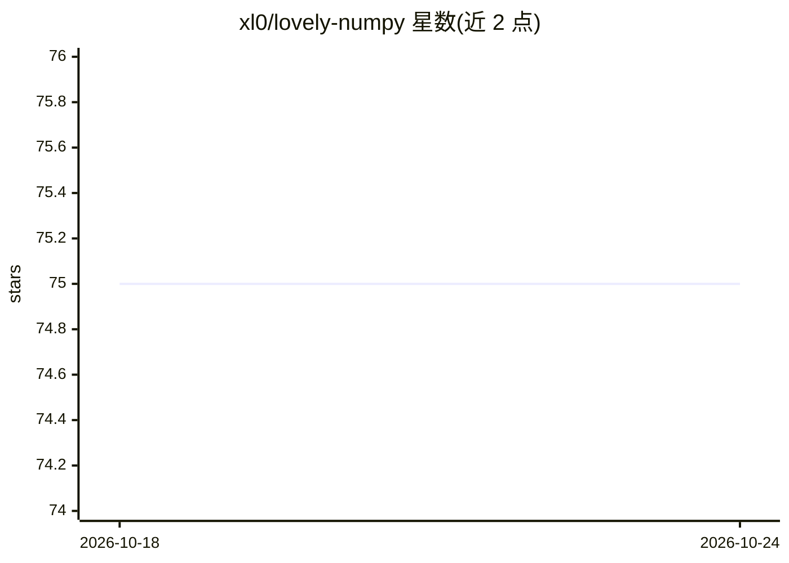

# xl0/lovely-numpy

⭐ 75 · Jupyter Notebook · MIT · 推送 2026-05-15 · [GitHub](https://github.com/xl0/lovely-numpy) · [官网](https://xl0.github.io/lovely-numpy) · 个人维护

**给开发者调试 NumPy 数组的人类可读展示库**

Python 库，替代 NumPy 数组的原始 repr 输出：以 lo() 包装数组，显示形状、dtype、元素数、取值范围、均值、标准差、数值分布微型直方图，并标注 NaN/Inf 与全零数组。支持 .deeper 逐层查看嵌套维度、.rgb/.chans 将数组按 ImageNet 统计量反归一化为图像、.plt 绘制直方图、matplotlib figure 导出，以及 set_config/config 全局或上下文配置精度与科学计数法。提供 lo() 包装对象与直接返回字符串的 lovely()/rgb()/chans()/plot() 两种用法。同作者另有面向 PyTorch/JAX/TinyGrad 的同类库。

## 筛选速览

| 维度 | 判定 | 备注 |
|---|---|---|
| AI 角色 | `ai-ecosystem` | LLM/agent 周边工具 |
| 许可风险 | `permissive` | MIT |
| 部署形态 | `library` | 以包/库形式分发 |
| 模型依赖 | — | README 未给出锁定关系 |
| 硬件要求 | — | 无带数字的原话,不猜 |
| 安装摩擦 | `low` | 无编译、无系统依赖或容器化 |
| 成熟度 | — | 结构信号不足 |

## 能力要点

- 单行输出包含 shape/dtype/范围/均值/σ/分布直方图并标注 NaN/Inf
- .deeper 按维度层级逐层展开查看嵌套数组
- .rgb/.chans 支持按 ImageNet 统计量反归一化渲染图像
- set_config/config 配置精度、科学计数法与颜色，matplotlib figure 可导出

## 适用场景

- 在 notebook 中快速检查张量的统计分布与异常值
- 调试归一化图像张量时直接可视化内容
- 检查深度学习输入数据的数值健康度（NaN/Inf/全零）

## 场景标签

 · 领域:科学计算/开发工具

## 证据(README 行号)

> L32: How often do you find yourself debugging NumPy code? You dump your
> L79: lo(numbers)

## 星数曲线

2026-10-18 75 → 2026-10-24 75（+0）

---
*卡片 v1 · prompt 1.4 · 生成 2026-10-24 · 置信度 mid · 依据 README sha `5e1da7eebcac` · [字段定义](../../DATASET.md)*
