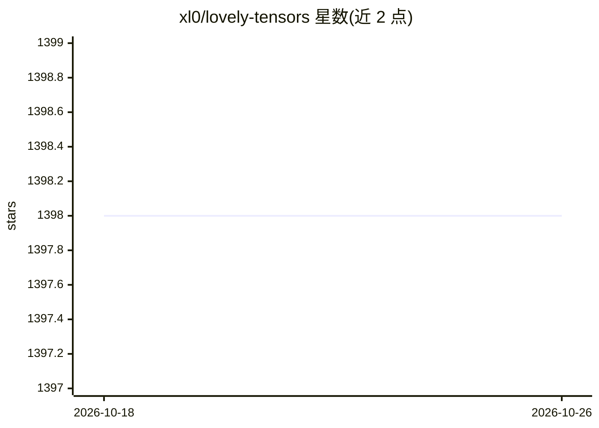

# xl0/lovely-tensors

⭐ 1,398 · Jupyter Notebook · MIT · 推送 2026-04-09 · [GitHub](https://github.com/xl0/lovely-tensors) · [官网](https://xl0.github.io/lovely-tensors) · 个人维护

**面向人类的 PyTorch 张量调试可视化库**

用于替代 PyTorch 张量原始数字堆输出的 Python 库：monkey_patch 后直接在 notebook 单元格中显示张量的形状、内存占用、取值范围、均值/标准度、直方图，并标出 +Inf/-Inf/NaN 与全零等异常状态；支持梯度信息显示、命名维度、递归逐层查看（.deeper）、图像渲染（.rgb）、通道可视化（.chans）、统计绘图（.plt）与 Matplotlib 集成。提供 import hook，设置 LOVELY_TENSORS=1 可不改代码自动加载，兼容 torch.compile()。面向进行深度学习调试的开发者，通过 pip/mamba/conda 安装。

## 筛选速览

| 维度 | 判定 | 备注 |
|---|---|---|
| AI 角色 | `ai-ecosystem` | LLM/agent 周边工具 |
| 许可风险 | `permissive` | MIT |
| 部署形态 | `library` | 以包/库形式分发 |
| 模型依赖 | — | README 未给出锁定关系 |
| 硬件要求 | — | 无带数字的原话,不猜 |
| 安装摩擦 | `low` | 无编译、无系统依赖或容器化 |
| 成熟度 | — | 结构信号不足 |

## 能力要点

- 张量摘要显示形状/统计量/直方图并标出 NaN/Inf/全零
- 梯度信息显示与 .deeper 逐层递归查看
- 图像 .rgb、通道 .chans 与统计 .plt 可视化
- import hook 环境变量加载，无需修改代码，兼容 torch.compile()

## 适用场景

- 调试 PyTorch 代码时快速查看张量统计与异常值
- 检查归一化前后图像数据或 CNN 激活/权重分布
- 在 notebook 中以人类可读形式展示张量并导出 Matplotlib 图

## 场景标签

 · 领域:深度学习/开发者工具

## 证据(README 行号)

> L38: How often do you find yourself debugging PyTorch code? You dump a tensor
> L90:  tensor[3, 196, 196] n=115248 (0.4 MiB) x∈[-2.118 |▂▅█▇▂▁▁▂▂▁| 2.640] μ=-0.388 σ=1.073

## 星数曲线

2026-10-18 1,398 → 2026-10-26 1,398（+0）

---
*卡片 v1 · prompt 1.4 · 生成 2026-10-21 · 置信度 high · 依据 README sha `819e0a00220e` · [字段定义](../../DATASET.md)*
