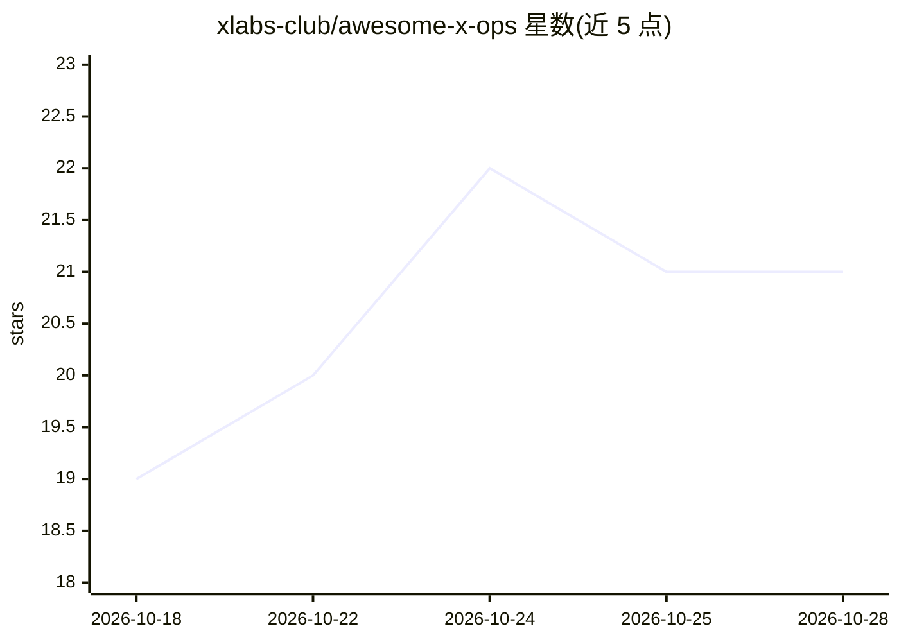

# xlabs-club/awesome-x-ops

⭐ 21 · 推送 2026-10-08 · [GitHub](https://github.com/xlabs-club/awesome-x-ops) · 组织维护 · 中文 README

**现代 X-Ops 开源工具策展清单：AI Ops、平台工程、GitOps 等**

一份策展式开源工具地图，覆盖 LLM/Agent 可观测性、平台工程、GitOps 与 Kubernetes 运维、FinOps、DevSecOps 与软件供应链、DataOps 及 AI 基础设施等类别。每个条目给出项目与一句话定位，部分类别附选型指引、生产检查清单与回归门禁建议。面向平台工程团队、DevOps/SRE、生产化运行 LLM/RAG/Agent 的 AI 工程团队，以及寻找开源替代的工程负责人。许可为 CC BY-NC 4.0，通过 Issue 与 PR 贡献。

## 筛选速览

| 维度 | 判定 | 备注 |
|---|---|---|
| AI 角色 | `ai-knowledge` | 知识聚合/清单类 |
| 许可风险 | `none` | — |
| 部署形态 | `self-host` | docker 或自建部署 |
| 模型依赖 | — | README 未给出锁定关系 |
| 硬件要求 | — | 无带数字的原话,不猜 |
| 安装摩擦 | `low` | 无编译、无系统依赖或容器化 |
| 成熟度 | — | 结构信号不足 |

## 能力要点

- 按 8 个技术栈类别组织的生产级运维工具清单
- LLM/Agent 可观测性章节含选型指引、生产检查清单与回归门禁建议
- 策展原则声明：只收录经验证的高质量项目，避免链接堆砌

## 适用场景

- 为 LLM/Agent 生产系统挑选追踪、评估与监控工具
- 平台工程团队搭建内部开发者平台时查找开源组件
- 对比 GitOps、FinOps、DevSecOps 各栈的开源选项

## 场景标签

 · 领域:运维/LLM 可观测性知识聚合

## 证据(README 行号)

> L3: A curated map of modern X-Ops: AI Ops, LLM/Agent Observability, Platform Engineering, GitOps, DataOps, FinOps, DevSe
> L19: - LLM and Agent Observability Stack: tracing, prompt monitoring, evaluation, feedback, and production telemetry for
> L57: ## LLM and Agent Observability

## 星数曲线

2026-10-18 19 → 2026-10-28 21（+2）

---
*卡片 v1 · prompt 1.4 · 生成 2026-10-28 · 置信度 mid · 依据 README sha `d2387ed13ae4` · [字段定义](../../DATASET.md)*
