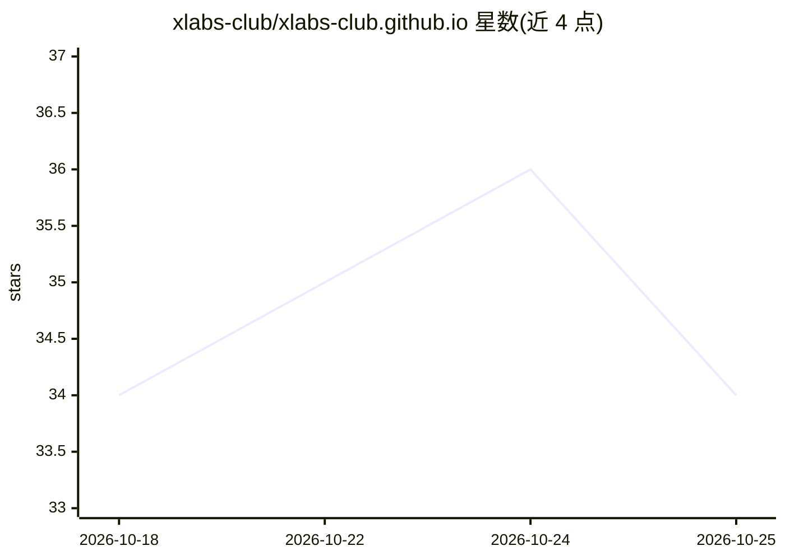

# xlabs-club/xlabs-club.github.io

⭐ 34 · HTML · 推送 2026-10-08 · [GitHub](https://github.com/xlabs-club/xlabs-club.github.io) · [官网](https://www.xlabs.club) · 组织维护 · 中文 README

**卫星实验室主页源码：平台工程与云原生实践博客**

基于 Hugo 的组织主页源码（xlabs.club），发布平台工程（DevOps/DataOps/FinOps/AIOps）、云原生技术博客与踩坑笔记，并维护 awesome-x-ops 精选清单与 xlabs-ops 运维脚本模板。内容含 MCP 协议边界实测、AI 生成 Playwright 选择器的多模型测试等 AI 工程实践文章。通过 npm 安装依赖并本地运行，接受 PR 共建，文章采用 CC BY-NC 4.0 许可。

## 筛选速览

| 维度 | 判定 | 备注 |
|---|---|---|
| AI 角色 | `ai-knowledge` | 知识聚合/清单类 |
| 许可风险 | `none` | — |
| 部署形态 | `library` | 以包/库形式分发 |
| 模型依赖 | — | README 未给出锁定关系 |
| 硬件要求 | — | 无带数字的原话,不猜 |
| 安装摩擦 | `low` | 无编译、无系统依赖或容器化 |
| 成熟度 | — | 结构信号不足 |

## 能力要点

- Hugo 静态站点，npm run dev/build 本地预览与编译
- 覆盖平台工程、云原生与 AIOps 等主题的博客内容
- 维护 awesome-x-ops 精选清单与 xlabs-ops IaC 运维模板

## 适用场景

- 查阅平台工程与云原生实践经验
- 参考 MCP 协议与 AI 工具的实测笔记
- 提交 PR 参与开源共建

## 场景标签

`精选清单` · 领域:学习与行业

## 证据(README 行号)

> L12: 此项目为卫星实验室主页 [xlabs.club][] 的源码，在这里分享我们的平台工程实践经验，介绍如何以技术驱动业务长期发展和高速增长。
> L23: - **awesome-x-ops** — AIOps/DataOps/DevOps/GitOps/FinOps 的优秀软件、博客与工具精选。

## 星数曲线

2026-10-18 34 → 2026-10-25 34（+0）

---
*卡片 v1 · prompt 1.4 · 生成 2026-10-25 · 置信度 high · 依据 README sha `0b9f0be7d1d6` · [字段定义](../../DATASET.md)*
