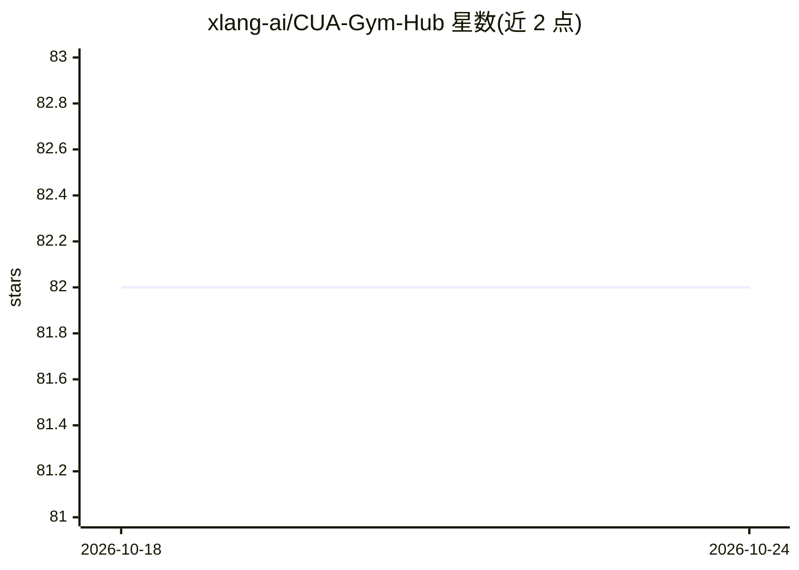

# xlang-ai/CUA-Gym-Hub

⭐ 82 · JavaScript · NOASSERTION · 推送 2026-09-03 · [GitHub](https://github.com/xlang-ai/CUA-Gym-Hub) · [官网](https://cua-gym.xlang.ai) · 组织维护

**98 个自包含 mock Web 应用的集合，作为计算机使用智能体的可复现 RL 训练环境**

面向计算机使用智能体（CUA）强化学习训练的沙盒集合：提供 98 个复刻真实商业产品 UI 与交互行为的 React 单页应用（邮件、项目管理、电商、财务等 7 类），无需认证与外部网络。关键机制是任务创建时注入 JSON 初始状态（?sid=<task_id> 渲染对应任务世界），并以会话 ID 命名空间隔离状态文件，支持并行 RL worker 互不干扰；通过统一 HTTP API 暴露 initial/current/state_diff，供奖励函数判定任务完成。提供 UDA 加固模式防止 shell 与浏览器混合访问的智能体读取任务状态。作为 CUA-Gym 的子模块，声明仅限研究用途，mock 界面使用刻意改动的品牌名。

## 筛选速览

| 维度 | 判定 | 备注 |
|---|---|---|
| AI 角色 | `ai-ecosystem` | LLM/agent 周边工具 |
| 许可风险 | `none` | NOASSERTION |
| 部署形态 | `library` | 以包/库形式分发 |
| 模型依赖 | — | README 未给出锁定关系 |
| 硬件要求 | — | 无带数字的原话,不猜 |
| 安装摩擦 | `low` | 无编译、无系统依赖或容器化 |
| 成熟度 | — | 结构信号不足 |

## 能力要点

- 98 个 mock 应用，状态可注入、可检视、可通过 HTTP API 重置
- 会话隔离机制支持数百并行 episode 共享同一 mock 后端
- state_diff 供 RL 奖励函数判定任务完成
- UDA 加固模式支持 shell+浏览器混合访问的评测场景

## 适用场景

- 为计算机使用智能体搭建可复现的 RL 训练环境
- 并行跑分布式 rollout 而互不污染状态
- 为 CUA 评测构造带隐藏状态的混合访问基准

## 场景标签

`浏览器自动化` `强化学习` `模型评测` · 领域:效率与自动化

## 证据(README 行号)

> L14: CUA-Gym-Hub is a suite of **98 self-contained mock web applications** built as RL training environments for compute
> L16: Each mock is a production-quality React SPA that faithfully replicates the UI and interactive behavior of a real co

## 星数曲线

2026-10-18 82 → 2026-10-24 82（+0）

---
*卡片 v1 · prompt 1.4 · 生成 2026-10-24 · 置信度 high · 依据 README sha `6b539d343ccd` · [字段定义](../../DATASET.md)*
