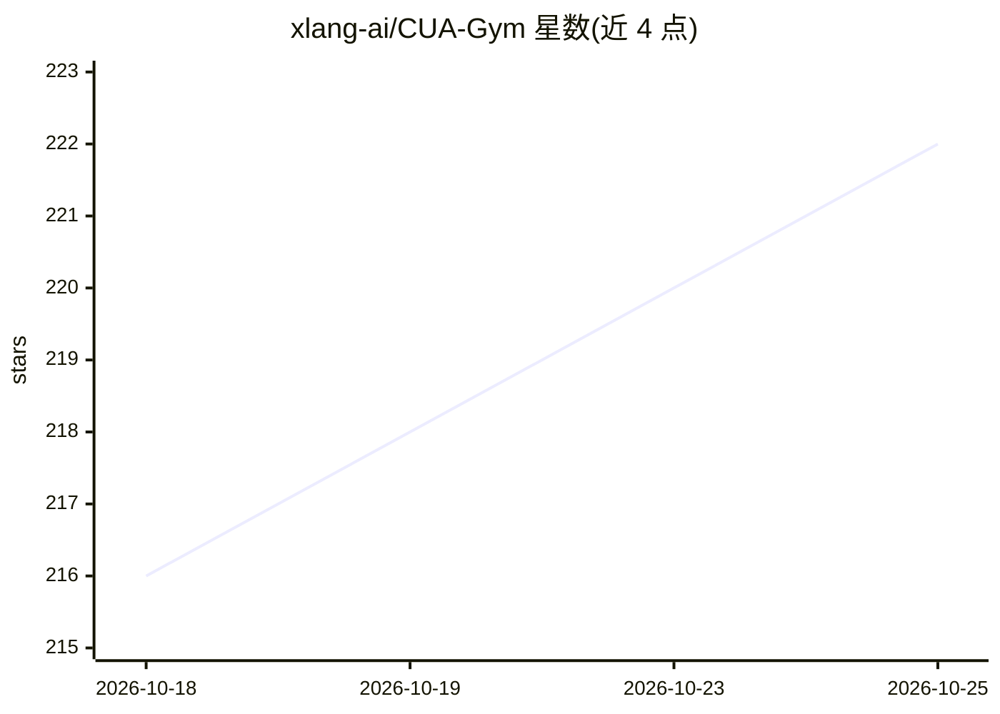

# xlang-ai/CUA-Gym

⭐ 222 · Python · NOASSERTION · 推送 2026-08-13 · [GitHub](https://github.com/xlang-ai/CUA-Gym) · [官网](https://cua-gym.xlang.ai) · 组织维护

**为计算机使用代理合成可验证 RLVR 训练数据的流水线与数据集**

面向计算机使用代理（CUA）的 RLVR 训练数据合成流水线：对给定主题，由 Generator、Discriminator、Orchestrator 三个代理协同生成任务指令、环境状态与奖励函数，经对抗式协同循环验证（reward(golden)=1.0、reward(initial)=0.0），再用 LLM 多数投票过滤器与教师 rollout 过滤。覆盖 110 个环境（16 个桌面应用 + 94 个合成 mock Web 应用），产出 32,112 条已验证训练元组，附带 CUA-Gym-Hub mock 环境套件与 Hugging Face 数据集下载。需配置 OPENAI_API_KEY 等凭据；Web 任务需自行部署 CUA-Gym-Hub 端点。训练模型尚未发布。

## 筛选速览

| 维度 | 判定 | 备注 |
|---|---|---|
| AI 角色 | `ai-ecosystem` | LLM/agent 周边工具 |
| 许可风险 | `none` | NOASSERTION |
| 部署形态 | `library` | 以包/库形式分发 |
| 模型依赖 | — | README 未给出锁定关系 |
| 硬件要求 | — | 无带数字的原话,不猜 |
| 安装摩擦 | `low` | 无编译、无系统依赖或容器化 |
| 成熟度 | — | 结构信号不足 |

## 能力要点

- 三代理对抗协同循环产出经验证的任务-环境-奖励三元组
- 110 个环境（16 桌面应用 + 94 合成 mock Web 应用）
- 32,112 条已验证 RLVR 训练元组，Hugging Face 公开下载
- CUA-Gym-Hub 提供统一状态 API 的 mock Web 应用，支持状态注入与会话隔离

## 适用场景

- 为计算机使用代理构建可验证的强化学习训练任务
- 自行部署 mock Web 环境进行 CUA 训练与评测
- 下载现成 RLVR 数据集训练自己的 CUA 模型

## 场景标签

`强化学习` · 领域:训练与推理

## 证据(README 行号)

> L16: CUA-Gym is a scalable pipeline for synthesizing verifiable RLVR training data for computer-use agents (CUAs). Given
> L27: Training computer-use agents with reinforcement learning requires a consistent triple of **(task instruction, execu
> L39: **Dataset.** The resulting CUA-Gym dataset contains **32,112** verified RLVR training tuples.

## 星数曲线

2026-10-18 216 → 2026-10-25 222（+6）

---
*卡片 v1 · prompt 1.4 · 生成 2026-10-22 · 置信度 mid · 依据 README sha `bab19cecc4a7` · [字段定义](../../DATASET.md)*
