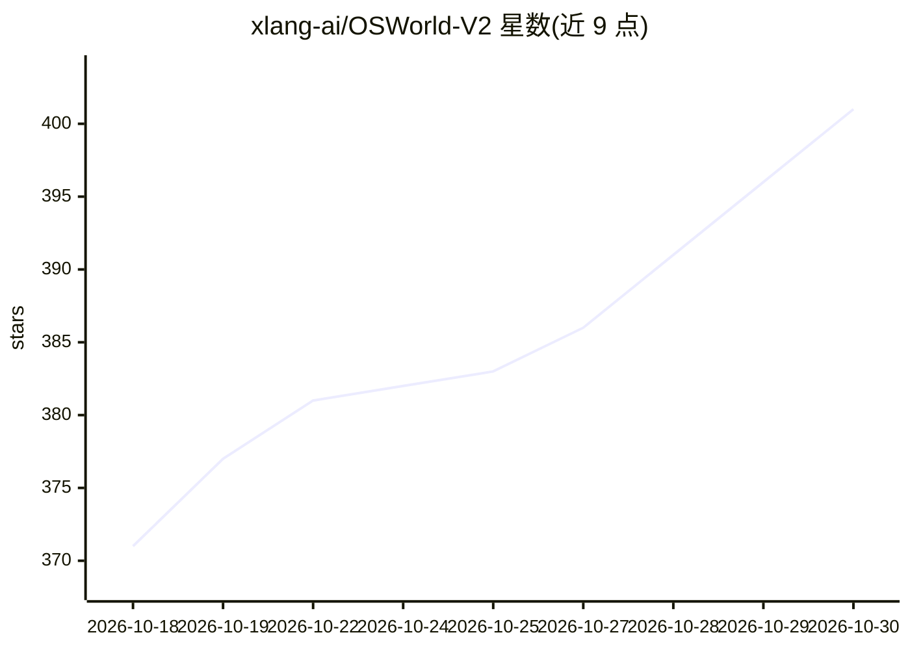

# xlang-ai/OSWorld-V2

⭐ 401 · Python · Apache-2.0 · 推送 2026-10-23 · [GitHub](https://github.com/xlang-ai/OSWorld-V2) · [官网](https://osworld-v2.xlang.ai) · 组织维护

**计算机使用智能体（CUA）长程真实任务评测基准**

OSWorld 2.0/2.1 是面向 computer use agent 的基准环境：在真实操作系统（Ubuntu 虚拟机/云主机）中布置长程跨应用任务，配套 Python 任务类、资产快照、模拟网站与 GitLab 自托管组件，并以固定版本的发布清单（release manifest）保证评测可复现。任务类与资产通过 Hugging Face 门控数据集分发以降低基准泄漏。运行环境支持 Docker 与 AWS 两种 provider（VMware/Azure/GCP/阿里云/火山引擎仅存代码路径），要求 Python>=3.12 并用 uv 管理依赖；同时提供 setup-osworld 技能让 agent 辅助部署。

## 筛选速览

| 维度 | 判定 | 备注 |
|---|---|---|
| AI 角色 | `ai-ecosystem` | LLM/agent 周边工具 |
| 许可风险 | `permissive` | Apache-2.0 |
| 部署形态 | `library` | 以包/库形式分发 |
| 模型依赖 | — | README 未给出锁定关系 |
| 硬件要求 | — | 无带数字的原话,不猜 |
| 安装摩擦 | `medium` | 含编译或系统依赖之一 |
| 成熟度 | — | 结构信号不足 |

## 能力要点

- 真实 OS 环境中的长程跨应用任务评测
- 任务类/资产经 Hugging Face 门控数据集分发以降低基准泄漏
- Docker 与 AWS 两种 provider，发布清单固定各组件版本保证可复现
- 提供 setup-osworld 技能供 agent 单条提示完成部署

## 适用场景

- 评测 GUI/computer use agent 在长程真实任务上的表现
- 复现论文基准结果或对比不同 agent 版本
- 大规模并行跑评测（AWS provider）

## 场景标签

`模型评测` · 领域:评测与运维

## 证据(README 行号)

> L200: OSWorld 2.1 can run with different environment providers depending on where you test:
> L235: The official OSWorld 2.1 Python task classes are distributed through the gated Hugging Face dataset `xlangai/oswor

## 星数曲线

2026-10-18 371 → 2026-10-30 401（+30）

---
*卡片 v1 · prompt 1.4 · 生成 2026-10-21 · 置信度 mid · 依据 README sha `a459bb6870d8` · [字段定义](../../DATASET.md)*
