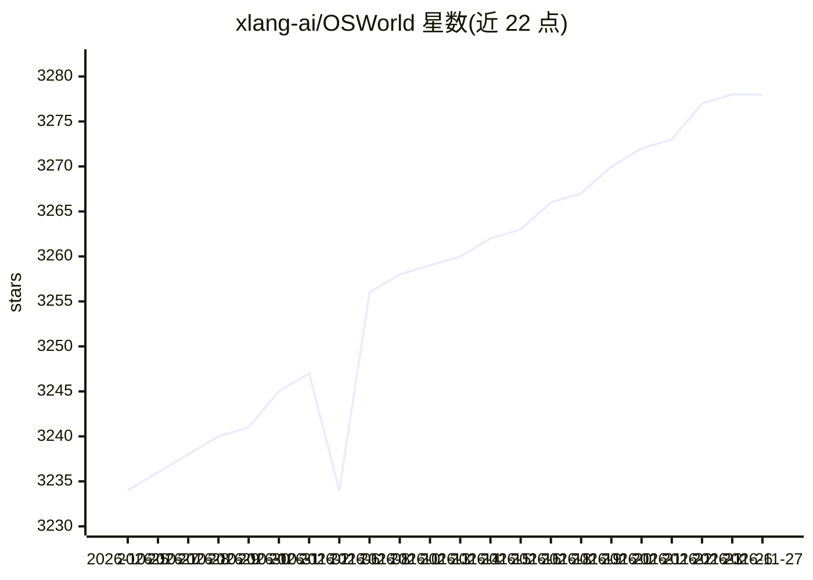

# xlang-ai/OSWorld

⭐ 3,278 · Python · Apache-2.0 · 推送 2026-11-23 · [GitHub](https://github.com/xlang-ai/OSWorld) · [官网](https://os-world.github.io) · 组织维护

**在真实计算机环境中评测多模态 Agent 的基准**

提供包含任务、虚拟机环境与评测脚本的多模态 Agent 基准：任务覆盖真实操作系统中的开放式操作，环境基于 Ubuntu/Windows 虚拟机，支持 VMware、VirtualBox、Docker、Modal、Daytona、AWS 等多种运行后端。用户需实现 agent 接口并导入运行脚本，结果包含截图、动作与录像，脚本输出分领域成功率与总分。部分任务需 Google 账号 OAuth 配置，公开榜单需与维护方预约运行。

## 筛选速览

| 维度 | 判定 | 备注 |
|---|---|---|
| AI 角色 | `ai-ecosystem` | LLM/agent 周边工具 |
| 许可风险 | `permissive` | Apache-2.0 |
| 部署形态 | `library` | 以包/库形式分发 |
| 模型依赖 | — | README 未给出锁定关系 |
| 硬件要求 | — | 无带数字的原话,不猜 |
| 安装摩擦 | `low` | 无编译、无系统依赖或容器化 |
| 成熟度 | — | 结构信号不足 |

## 能力要点

- 多后端虚拟机环境：VMware/VirtualBox/Docker/Modal/Daytona/AWS
- AWS 并行评测可将评估时间缩短至 1 小时以内（README 自述）
- 结果含截图、动作与录像，输出分领域成功率与总分
- 提供手动检查工具用于核对任务与评测指标

## 适用场景

- 在我的 agent 上运行该基准并获取各领域成功率
- 用 Docker/KVM 在服务器上并行执行评测
- 用手动检查工具核对特定任务的评测指标

## 场景标签

`模型评测` `多模态` · 领域:评测与运维

## 证据(README 行号)

> L32: - 2024-04-11: We released our paper, environment and benchmark, and project page. Check it out!
> L88: Add the following arguments when initializing `DesktopEnv`:
> L219: Correctly implement the agent interface and import your customized version in the `run.py` (for single-threaded ex

## 星数曲线

2026-10-25 3,234 → 2026-11-27 3,278（+44）

---
*卡片 v1 · prompt 1.4 · 生成 2026-11-24 · 置信度 high · 依据 README sha `d9d8a1da537e` · [字段定义](../../DATASET.md)*
