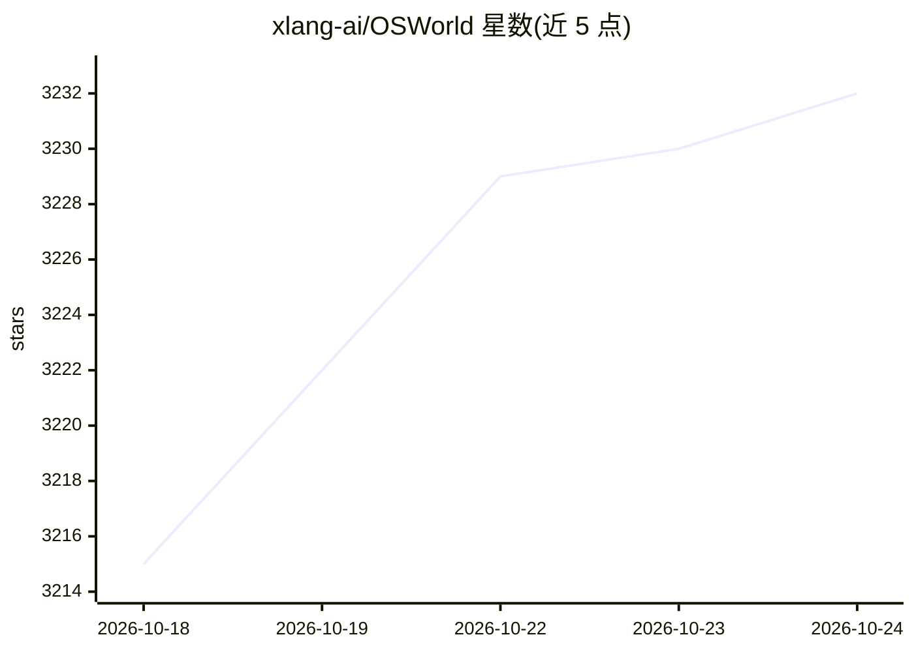

# xlang-ai/OSWorld

⭐ 3,232 · Python · Apache-2.0 · 推送 2026-10-23 · [GitHub](https://github.com/xlang-ai/OSWorld) · [官网](https://os-world.github.io) · 组织维护

**评测多模态 Agent 在真实计算机环境中执行任务的开源基准**

NeurIPS 2024 论文配套的基准平台：在 Ubuntu/Windows 虚拟机（VMware、VirtualBox、Docker/KVM、Modal、Daytona、AWS）中提供 369+ 开放式真实任务，覆盖办公、日常与专业场景，评测多模态 Agent 的 GUI 操作能力。支持单线程/并行实验，输出截图、动作与录屏结果及分领域成功率；含基线 Agent（GPT-4o 纯截图设置）、人工任务检查工具与公开评测排行榜。运行需 Python>=3.10 与虚拟化环境。

## 筛选速览

| 维度 | 判定 | 备注 |
|---|---|---|
| AI 角色 | `ai-ecosystem` | LLM/agent 周边工具 |
| 许可风险 | `permissive` | Apache-2.0 |
| 部署形态 | `library` | 以包/库形式分发 |
| 模型依赖 | — | README 未给出锁定关系 |
| 硬件要求 | — | 无带数字的原话,不猜 |
| 安装摩擦 | `low` | 无编译、无系统依赖或容器化 |
| 成熟度 | — | 结构信号不足 |

## 能力要点

- 真实计算机环境（多操作系统虚拟机）中的开放式任务基准
- 多平台运行时支持：VMware/VirtualBox、Docker+KVM、Modal、Daytona、AWS 并行评测
- 结果包含截图、动作序列、视频录制及分领域成功率统计
- 提供公开评测排行榜与人工任务检查工具

## 适用场景

- 评测自研 GUI 多模态 Agent 在真实电脑任务上的成功率
- 以并行化基础设施（AWS/Docker）加速或规模化训练评测
- 人工核查基准任务的正确性与评测指标

## 场景标签

`模型评测` · 领域:评测与运维

## 证据(README 行号)

> L28: - 2025-07-28: Introducing **OSWorld-Verified**! We have made major updates, fixed several issues reported by the co
> L204: ## Evaluation
> L210: ### Public Evaluation

## 星数曲线

2026-10-18 3,215 → 2026-10-24 3,232（+17）

---
*卡片 v1 · prompt 1.4 · 生成 2026-10-20 · 置信度 high · 依据 README sha `c972e0ddefe5` · [字段定义](../../DATASET.md)*
